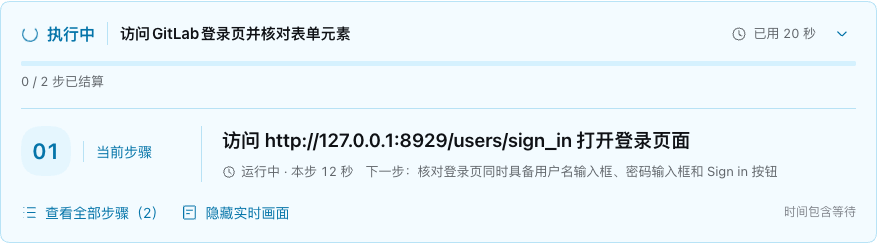
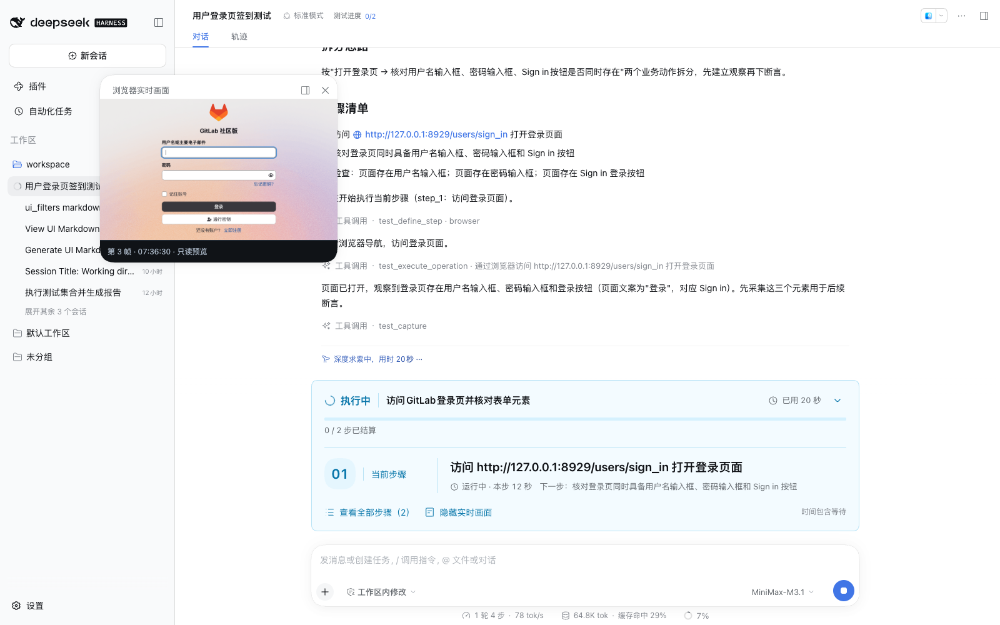
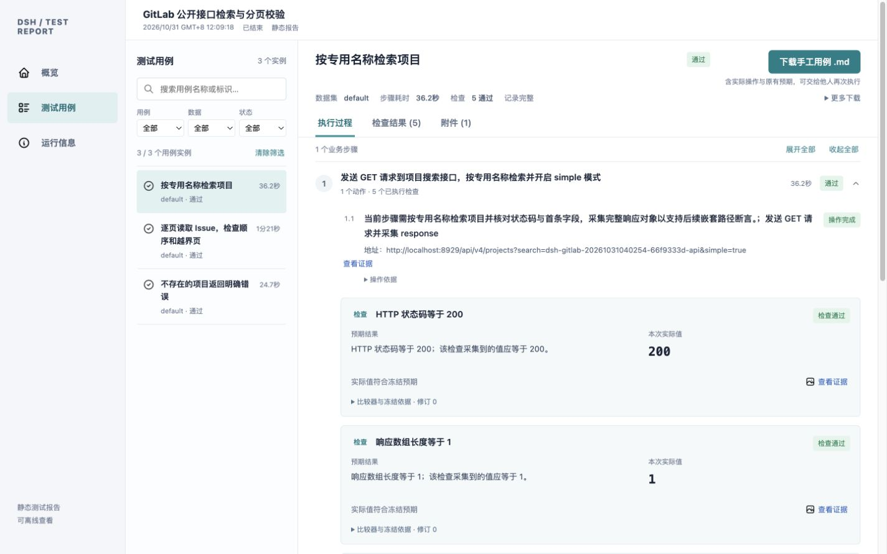

# DSH Test Plugin

**Plan, execute, and deliver tests in a DeepSeek Harness conversation using natural language.**

[简体中文](README.md) · English · [Quick start](#quick-start) · [Documentation](doc/README.md) · [Changelog](changelog.md) · [Issues](https://github.com/Pegasus-Yang/DSH-Test-Plugin/issues)

DSH Test Plugin is a native testing plugin for DeepSeek Harness (DSH). Describe the business flow you want to verify: the plugin builds a plan, checks the actual page or API response, and presents progress, evidence, and results in the same conversation. It uses that conversation's model, tools, approvals, and saved history, supporting browser UI tests and GET JSON API tests.

For both exploration and repeatable testing, enter a task directly or maintain TXT and Markdown cases with CSV parameters. Each run can produce a reviewable HTML report and a Markdown manual case for another tester to execute.

**Browser connections support only Playwright MCP and RunBridge MCP.** Other MCP servers or browser tools, including Selenium MCP, Chrome DevTools MCP, and Playwright CLI, cannot substitute for them. GET JSON API tests use the plugin's own collector and need no browser MCP.

## Highlights

| Capability | What you can do |
| --- | --- |
| Natural-language planning and review | Split a task into business steps and checks; execute directly, or review and revise the plan first |
| Browser and API testing | Operate a local Playwright MCP or remote RunBridge MCP browser and determine concrete actions from the actual page; capture GET JSON responses and check status codes or response fields |
| File cases and parameters | Save cases as TXT or Markdown, expand CSV rows, and review each instance before serial execution |
| Progress and timing | See the current step, settled count, and elapsed time above the input; expand the full list for long text and multiple instances |
| Live preview and recording | Watch headless browser frames in the same page; independently enable recording, then play, seek, and download MP4 from the report |
| Evidence and reports | Preserve observations, expectations, and sources; compute assertion results in code and generate static HTML reports with steps, assertions, and attachments, supporting offline saving and rebuilding |
| Actual steps and manual cases | Record concrete operations individually and export numbered actions and expectations as Markdown manual cases with prerequisites and cleanup |

## Screenshots

These screenshots show actual runs with GitLab as the system under test, using the Chinese UI.

**Follow what is happening.** The progress area shows the current action, settled count, total duration, and step duration. Expand it to inspect the complete list.



**Watch the browser within the conversation.** The floating preview appears alongside conversation records and step progress. Move, resize, show, or hide it as needed.



**Review results against evidence.** Reports group planning, actual operations, and checks into one execution process, comparing complete expectations with captured values. The case header downloads a manual Markdown case for another person to execute. Browser cases can include recordings; API cases show their requests and checks.



See the [visual tour](doc/user-guide/使用说明.en.md#visual-tour) for more plan-review, expanded-step, and report screenshots.

## Quick start

### 1. Prepare DSH and testing tools

- Node.js **22.19+**, and DeepSeek Harness **0.2.1-alpha.1–alpha.5 and rc.1–rc.5** with a working model configured.
- DSH **native tool mode**; browser tests support only the two connections below.
- API-only tests need no browser. DSH CLI plugin installation and source development require pnpm **11.7.0**.

| Connection | Use it when | Installation and usage |
| --- | --- | --- |
| Playwright MCP | DSH and the browser run on the same machine; recommended for getting started | Install `@playwright/mcp@0.0.68` and its matching Chromium, then register it in DSH; see [local setup](doc/deployment/安装与运维.en.md#install-local-playwright-mcp) |
| RunBridge MCP | The browser runs on a remote machine or VM | Deploy [Hub](https://github.com/Pegasus-Yang/Run-Bridge-Hub#快速开始) and [Node](https://github.com/Pegasus-Yang/Run-Bridge-Node#快速开始), then save the private connection file using the [remote guide (Chinese)](doc/user-guide/RunBridge远程浏览器与持续预览.md); no local Playwright MCP is needed |

See [DSH installation commands](doc/deployment/安装与运维.en.md#prepare-dsh). The existing RunBridge integration baseline is **Hub 0.9.1 / Node 0.8.1**; see the remote guide for validation scope.

### 2. Install and enable the plugin

**Option A: ask an Agent to install it.** Give an Agent with terminal and file access the [Agent installation guide (Chinese)](doc/deployment/Agent自动安装插件与PlaywrightMCP.md) and this prompt. It covers environment checks, plugin and Playwright MCP installation, DSH configuration, and a first test.

```text
Follow https://github.com/Pegasus-Yang/DSH-Test-Plugin/blob/main/doc/deployment/Agent自动安装插件与PlaywrightMCP.md to install DSH Test Plugin and Playwright MCP, then complete its acceptance checks. Reuse my existing DSH environment and model configuration. List any information you need from me.
```

**Option B: install manually.** Prepare a browser connection from the table above, then choose one plugin source below.

For local review, install the same tgz supplied by the maintainer:

```sh
dsh plugin --profile web add /absolute/path/dsh-test-plugin-0.17.0.tgz
dsh web
```

After completed acceptance, review, and a manual push, enter this repository address in DSH's plugin manager, then enable the plugin:

```text
https://github.com/Pegasus-Yang/DSH-Test-Plugin.git#v0.17.0
```

Alternatively, install with the standalone DSH CLI:

```sh
dsh plugin --profile web add github:Pegasus-Yang/DSH-Test-Plugin#v0.17.0
dsh web
```

Stop a running DSH normally before CLI installation. Use the same profile and `DSH_HOME` for installation and startup, then refresh the page. When running from the DSH source checkout, replace `dsh` with `pnpm dsh`. Git releases include built artifacts and can be installed directly.

See [installation and deployment](doc/deployment/安装与运维.en.md) for upgrades, uninstalling, and local packages.

All 10 hosts use the same package without version exemptions. The build SDK remains alpha.3; ordinary plugin upgrades retain the supported hosts. See the [validation status (Chinese)](doc/project/0.17.0版本发布验收.md) and [dsh-compatibility.json](dsh-compatibility.json) for the exact support set.

### 3. Run your first test in a conversation

With a reachable GitLab login page, enter this in the **DSH conversation input**:

```text
/test Visit http://127.0.0.1:8929/users/sign_in and verify that the page has a username field, a password field, and a Sign in button.
```

Replace the URL with your GitLab address. This check needs no account. For GitLab deployment, follow the [official Docker documentation](https://docs.gitlab.com/install/docker/); see the [GitLab testing guide (Chinese)](doc/user-guide/GitLab测试要求与本地调试.md) for system and account requirements.

The plugin presents a plan, executes steps with progress updates, and returns the result and report link. Use `/test-plan` to review the plan first. For file cases, select their directory as the current conversation's workspace; paths are resolved within that workspace.

### 4. Optionally enable preview and recording

Install the local Browscreen command. In **Settings → 测试插件 → 浏览器预览与录像**, enable preview or recording as needed, check the installation, select the dedicated Playwright MCP, and save. Continue using the normal test commands; the plugin starts capture when needed.

Preview appears only after the current browser has a usable CDP connection and a valid first frame. Recording has an independent toggle and is off by default; hiding the preview does not stop enabled recording. API instances display no browser frames or video sections.

See [preview setup (Chinese)](doc/user-guide/浏览器实时预览一步一步配置.md) and [recording and reports (Chinese)](doc/user-guide/浏览器录像与报告.md) for installation requirements and instructions.

## Commands and examples

Use these commands in the DSH conversation input:

| Command | Purpose |
| --- | --- |
| `/test <task>` | Present a plan and execute directly |
| `/test-plan <task>` | Review and revise a plan before execution |
| `/test-run <file>` | Read and execute TXT or Markdown cases from the current workspace |
| `/test-data <CSV> --file <case file>` | Expand parameters from CSV, then review and execute |

Use DSH's native Stop button to stop a run. After completion, rebuild a report from the progress area or plugin settings. See the [user guide](doc/user-guide/使用说明.en.md) for input rules and UI operations.

For a fuller workflow, try the [GitLab examples (Chinese)](examples/gitlab/README.md): two UI cases cover combined filtering and draft preview cancellation; three API cases cover search, pagination, and error responses, with a CSV parameter template also provided. Follow the [testing guide (Chinese)](doc/user-guide/GitLab测试要求与本地调试.md) to prepare a dedicated account and run-specific data. Credentials remain in a local configuration excluded from Git.

## Supported scope

- Browser execution supports only **Playwright MCP / RunBridge MCP**. Browser tools installed in another Agent, or another MCP renamed to `playwright`, do not provide the required DSH connection.
- Runs in DSH native tool mode with a shared, serial test environment. Independent browsers for concurrent conversations are a [future improvement (Chinese)](doc/design/多对话并行测试优化方案.md).
- API collection supports **GET JSON**. Automatic preview uses a local Chromium Playwright MCP and currently supports one active page.
- Natural-language and file cases both use the current conversation's model. Report rebuilding reads saved records without rerunning cases.
- Results preserve failures, cancellation, and cleanup status. Missing evidence, tool errors, or required cleanup failures do not count as passes. Report UI and some messages are primarily Chinese.

## Documentation and help

| Start here | Contents |
| --- | --- |
| [Documentation index (Chinese)](doc/README.md) | Usage, deployment, architecture, design, and acceptance records |
| [User guide](doc/user-guide/使用说明.en.md) | Commands, files, parameters, plan review, and reports |
| [CSV parameter handbook (Chinese)](doc/user-guide/CSV参数文件使用手册.md) | Copyable examples, placeholders, expansion, review, and common errors |
| [GitLab requirements and local debugging (Chinese)](doc/user-guide/GitLab测试要求与本地调试.md) | System and account requirements, complex cases, data preparation, and plugin debugging |
| [Steps and progress (Chinese)](doc/user-guide/执行步骤与进度显示.md) | Expanded steps, run phases, and timing |
| [Actual steps and manual cases (Chinese)](doc/user-guide/实际步骤与手工用例.md) | Operation records and reusable manual-case exports |
| [Preview setup (Chinese)](doc/user-guide/浏览器实时预览一步一步配置.md) · [Recording and reports (Chinese)](doc/user-guide/浏览器录像与报告.md) | Live frames, video dependencies, playback, and downloads |
| [Installation and deployment](doc/deployment/安装与运维.en.md) · [Troubleshooting (Chinese)](doc/deployment/常见问题速查与处理.md) | Installation, upgrades, uninstalling, recovery, and common issues |
| [Agent installation guide (Chinese)](doc/deployment/Agent自动安装插件与PlaywrightMCP.md) | Agent instructions for installing the plugin, Playwright MCP, and Chromium, then verifying a first test |
| [Current architecture (Chinese)](doc/architecture/当前实现.md) | Module responsibilities and execution flow |

## Development and contributions

Report issues or propose improvements through [Issues](https://github.com/Pegasus-Yang/DSH-Test-Plugin/issues). Include plugin, DSH, Node.js, and MCP versions, reproduction steps, and redacted error details.

Develop from source:

```sh
git clone https://github.com/Pegasus-Yang/DSH-Test-Plugin.git
cd DSH-Test-Plugin
pnpm install --frozen-lockfile
pnpm typecheck
pnpm build
pnpm test:unit
pnpm test:integration
```

See [installation and deployment](doc/deployment/安装与运维.en.md) for local packaging and isolated debugging, and [development and acceptance records (Chinese)](doc/project/开发进度.md) for verified test coverage. Run the relevant checks and update affected documentation before submitting changes. Keep credentials, logs, and raw run data in local directories excluded from Git.

## License

[MIT](LICENSE). Third-party dependency and icon licenses are listed in [THIRD_PARTY_NOTICES.md](THIRD_PARTY_NOTICES.md).

Remote or VM browsers can use RunBridge Hub 0.9.1 / Node 0.8.1 with this plugin. See the [remote browser and live preview guide](doc/user-guide/RunBridge远程浏览器与持续预览.md) (Chinese). Live PNG preview and report screenshots are supported; remote video recording is not available.
