# RunBridge 远程执行与画面

[文档导航](../README.md) · [使用指南](../user-guide/RunBridge远程浏览器与持续预览.md) · [历史提案](../design/runbridge-mcp/README.md)

本文描述插件 0.13.2 与 RunBridge Hub/Node 0.7.0 的实现。每次测试冻结浏览器后端和私有访问配置，继续附着在发起命令的当前 DSH Agent。旧版 MCP 的工具兼容路径保留；旧 Hub 0.5.1 / Node 0.5.0 的历史验收见原记录，不作为本轮新版实测。

```mermaid
flowchart LR
    Input[TXT Markdown CSV] --> Test[当前 Agent 测试作用域]
    Test --> Native[DSH 原生工具管线]
    Native --> Bridge[公开 MCP 工具投影与绑定]
    Bridge -->|HTTP tools/call| Hub[Hub 鉴权与指令路由]
    Hub -->|执行协议 2| Node[Node Python worker 与 Chromium]
    Node -->|同一 Page 的 PNG 上传| Stream[Hub 会话画面分发]
    Stream --> Cache[插件服务端最新帧]
    Cache -->|同源图片路由| Preview[现有只读浮窗]
```

`runbridge.ts` 使用官方 MCP Client 2.0.0 和公开 DSH `createMcpToolDefinition`，在 Agent 作用域注册 `mcp__runbridge__*`；沿用原生审批、取消、错误及图片附件投影。私有令牌只用于服务端 HTTP 和 WebSocket 首消息认证，浮窗不直接访问 Hub。运行状态暴露资源身份，省略私有文件路径和令牌。

插件管理 node_id/resource_id/lease/启动 request_id；启动后管理 session_id/page_id。页面选择只能使用本会话返回的 ID；默认列页保持绑定，关闭当前页后必须明确新建或选择。`tool_request_status` 单独保留原动作 request_id，session_id 继续绑定本轮，不注入或依赖 page_id。所选后端以外的浏览器 MCP 被当前测试守卫拒绝。接口用例不会申请浏览器。MCP Client 标识从包清单读取版本。

生命周期与可信采集只经内部子调用进入原生工具管线；业务操作由 `test_execute_operation` 先保存说明，再转交对应原子工具。对象参数继续支持；`arguments_json` 为完整 JSON 字符串，防止宿主将无类型的嵌套数组转换成对象，仍经 Schema 和工具守卫验证。Hub 提供固定 DOM 采集与 DOM 检视，不开放调用方任意 evaluate/run_code。

DOM 的 text/number/count/visible/url/attribute/value 保持原合同：Node 在同一次读取检查 origin，按冻结输出 Schema 绑定实际值与证据，截断数据不能通过。固定采集仅覆盖主页面；交互的 frame_selector 不代表采集支持 iframe。Node 对 DOM 返回结果执行 256 KiB 检查。截图保存公开投影之外保留的规范 MCP 原始 PNG。上传由插件读取明确的宿主文件路径，单文件或多文件原始字节合计不超过 4 MiB，再编码为 base64；Hub 接纳有界请求，Node 解码并检查总量，服务端不读取调用方指定的本机路径。

启动前持久保存 request_id 和未知资源；Hub 按 grant/node/request 保存无凭据的请求结果及首次分配的会话关联，运行 Task 完成后释放。重复请求不会新开浏览器或复活已结束会话；响应丢失时只核对原请求，不重放启动。

browser_sessions(node_id, request_id) 保留 sessions 数组，新增 request={request_id,node_id,grant_id,state,session_id,error_code,execution_outcome}。插件先核对原请求、节点和 grant，必要字段缺失或关联矛盾时保留隔离：

| 查询结果 | 插件处理 |
| --- | --- |
| FAILED、session_id=null、execution_outcome=NOT_STARTED，且 sessions 为空 | 确认本请求未分配会话，资源标为 absent；直接保留查询结果作收尾证据，不发送无会话身份的关闭请求 |
| PENDING、SUCCEEDED、FAILED 或 UNKNOWN，携带非空 session_id 且与唯一 sessions 项一致 | 验证真实会话归属后找回身份，执行同会话关闭；只有技术终态和 Node cleanup=COMPLETE 一起确认释放 |
| PENDING/UNKNOWN 无已知会话、NOT_FOUND、重复会话或身份不一致 | 保留未知资源和隔离，不将无记录当作未分配，也不自动重放启动 |
| 旧 Hub 未返回 request 对象 | 沿用同 request_id 的唯一 sessions 查询及会话归属校验；空列表不能证明没有分配 |

普通收尾适配器与设置页恢复复用同一证据判定；设置页审计分别保存实际清理会话或确定未分配请求，旧结果与报告保持原样。REQUEST_RECORD_LIMIT / REQUEST_CONCURRENCY_LIMIT 仅在明确收到分配前 NOT_STARTED 错误时认定未占用；这些响应丢失后仍须按原请求核对，NOT_FOUND 继续隔离。

预览通过已有 MCP 连接的 `browser_status` 读取本会话 visual，不调用已退役的 `GET /v1/sessions/{id}`。新版 HTTP 会话查询为 `/v2`，画面 WebSocket 仍为 `/v1/sessions/{id}/visual/stream`，版本不能一并替换。状态查询支持取消和 5 秒超时；HTTP 认证／许可拒绝或会话失效停止重连，网络中断允许重试，已切换代次的迟到响应不重建旧订阅。

Node Python worker 对执行所用同一 Page 约每 300 毫秒采集 PNG，独立于动作队列；`target_id` 与 page_id 一致。Hub 只鉴权和分发，不安装 Playwright、不创建页面或采集连接。插件继续核对 session/resource/page/connection_generation/stream/frame，Hub 与插件只保留最新帧，五秒无新帧撤图；结束、撤销和隔离停止订阅。画面失败不改写业务结果。

新版动作结果带 request_id。`tool_request_status` 查询原动作，不重放写入，也不把 SUCCEEDED 直接转换成业务 PASS。只有取得动作 ID 时才能查询；整个响应丢失且 ID 未知时继续保留未知状态，通过业务观察或原有恢复路径核实，不能猜测 ID 或重试提交。

受管理浏览器临时目录使用短 `/tmp/rb-*` 私有目录，仅在 Node 按所有权记录确认所属 worker／浏览器退出后删除。插件继续通过 MCP 创建独立受管理浏览器，不增加借用已有 Chrome 的入口。当前交付与旧版缺陷复现分别见[0.13.2 验收](../project/0.13.2版本发布验收.md)和[升级核查](../design/RunBridge升级对接核查.md)。
