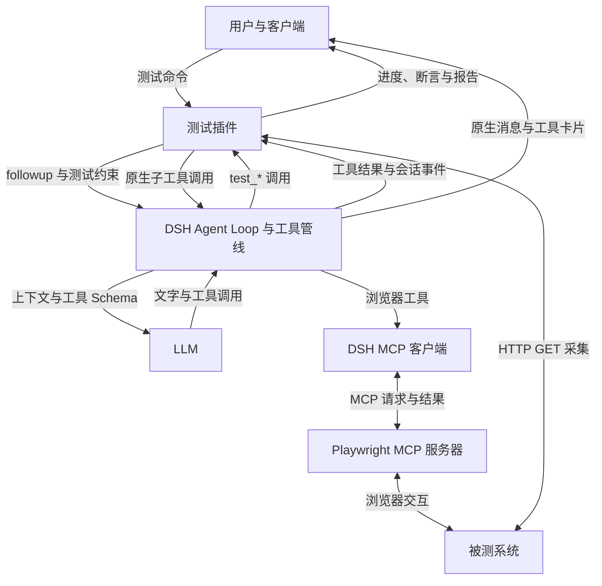
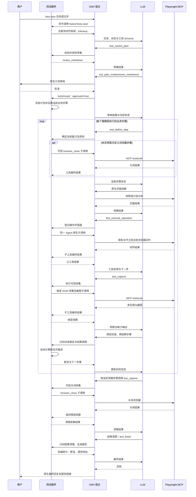
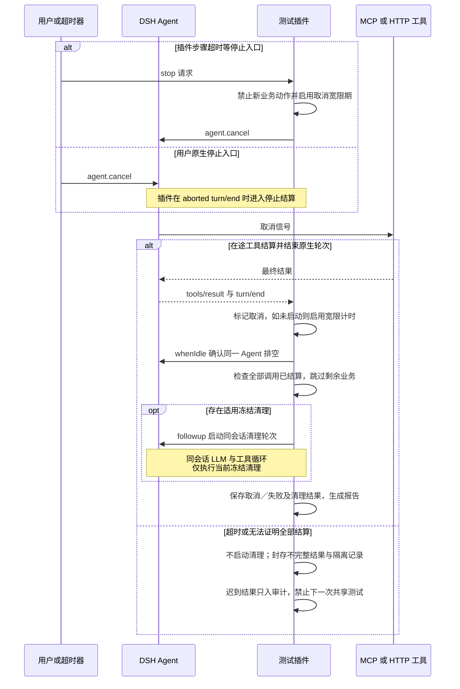

# 单条用例执行与参与者交互

本文按插件 **0.11.2** 的历史代码，说明一条用例从命令接收到生成报告的流转。插件代码核对基线为 `ed8361f`；宿主接口对照本项目安装的公开 DSH SDK **0.2.1-alpha.1**，Agent Loop 与 MCP 桥的内部实现另对照 DSH 固定源码快照 [`5badb15009ae1756c3afe0ae0cef1faafc290ccc`](https://github.com/deepseek-ai/deepseek-harness/tree/5badb15009ae1756c3afe0ae0cef1faafc290ccc)。源码快照与 npm 包分别核对，不以相同版本号推定产物逐文件相同。

0.12.0 新增远程后端及持续画面，具体差异见[RunBridge 远程执行与画面](RunBridge远程执行与画面.md)。下述 Playwright MCP 图示保留该基线的交互说明。

本次是代码与文档梳理；本文图示不是新一轮 LLM、MCP 或被测系统运行证据。模块清单见[当前实现](当前实现.md)，已有实际验收见[文档导航](../README.md)。

## 1. 谁驱动执行，谁决定结果

用例始终附着在发起命令的 **同一个 DSH Agent、Session 和对话** 上。DSH Agent Loop 持续向 LLM 请求下一步，执行模型返回的工具调用，再把工具结果加入上下文。插件在这个循环内提供测试状态、约束、工具和账本；LLM 根据当前步骤与工具反馈决定怎样操作。业务是否通过最终由插件的确定性断言与聚合规则计算。

| 参与者            | 负责什么                                                                                             | 接收与输出                                                                             |
| ----------------- | ---------------------------------------------------------------------------------------------------- | -------------------------------------------------------------------------------------- |
| 用户与 DSH 客户端 | 提交命令、补充信息、审核计划、批准工具、停止；显示原生对话、进度与报告                               | 输入任务或文件路径；接收流式回复、工具卡片和插件展示投影                               |
| 测试插件          | 解析文件和参数，管理冻结计划、当前步骤、阶段准入、实际操作记录、可信观察、断言、清理与报告           | 注册 `test_*` 工具和动态提示；消费宿主事件与工具结果；返回权威状态                     |
| DSH 宿主          | Agent Loop、模型路由与适配器、工具注册及执行管线、人工交互、会话日志与持久化                         | 向 LLM 发送上下文和工具 Schema；派发调用；将结果提交到会话，进入下一轮模型请求         |
| LLM               | 理解原文、拆分业务步骤、追问；执行时识别页面、选择工具与参数、定义采集和检查引用、调整定位、总结结果 | 返回说明文字及工具调用；不提供断言实际值，也不能直接设置 PASS                          |
| DSH MCP 客户端    | 连接服务器、发现工具、将 MCP 工具桥接到 DSH 工具注册表                                               | 将 `mcp__playwright__browser_click` 等公开名称映射为 MCP `tools/call` 的原始名称和参数 |
| MCP 服务器        | 例如 Playwright MCP：实际控制浏览器并提供页面、DOM、截图和关闭结果                                   | 接收 MCP 调用，返回规范 `content`、可选结构化内容及错误                                |
| 被测系统          | 对浏览器交互或 HTTP 请求作出实际业务响应                                                             | 页面、接口响应及外部业务状态                                                           |

MCP 是工具协议；具体执行工作由 MCP 服务器完成。这里需要把宿主内的 **MCP 客户端桥** 与外部 **MCP 服务器** 分开理解。



当前插件的浏览器适配器使用 Playwright MCP；HTTP 适配器通过插件内部 `test_api_get` 执行 `fetch()`，**接口采集不经过 MCP**。Skills 等宿主能力仍可提供方法指导，具体能否调用受当前测试阶段守卫约束。

### 三种不同的“步骤”

| 概念         | 含义                                                 | 与其他概念的关系                                                                                     |
| ------------ | ---------------------------------------------------- | ---------------------------------------------------------------------------------------------------- |
| 测试业务步骤 | 冻结计划中的一句业务目标，例如“搜索关键词并检查结果” | 插件保持一个当前步骤，直到完成、失败或取消                                                           |
| DSH 模型步骤 | Agent Loop 中一次上下文组装下的推理与工具处理循环    | 同一业务步骤通常需要多次模型请求；请求失败重试可仍属同一宿主步骤，模型也可能在一次响应中提出多个调用 |
| 工具调用     | 一次 `test_*`、原生浏览器工具或 HTTP 工具执行        | 一个模型工具调用还可在程序内产生多个子调用                                                           |

因此“一条用例”“一个业务步骤”“一次 LLM 请求”和“一次 MCP 请求”没有固定的一一对应关系。例如一次 `test_capture` 可以产生 DOM 读取与截图两次 MCP 调用，而这些子调用本身不另请求 LLM。

## 2. 从测试命令进入当前会话

入口由 [src/index.ts](../../src/index.ts) 注册，随后统一调用 `NativeTests.start()`：

| 用户入口                                          | 插件先做什么                                             | 是否先审核                                           |
| ------------------------------------------------- | -------------------------------------------------------- | ---------------------------------------------------- |
| `/test <描述>`                                    | 将原始描述交给当前 Agent 规划                            | 提交有效计划后，先在对话完整通报，再执行，无额外确认 |
| `/test-run cases.md` 或 TXT                       | 在当前会话工作区读文件，解析用例并保留原文               | 与 `/test` 相同                                      |
| `/test-plan <描述>` 或 `--file cases.md`          | 启用当前会话的原生 plan 模式，规划草案                   | 必须经原生计划审核批准                               |
| `/test-data data.csv <模板>` 或 `--file cases.md` | 程序解析 CSV、替换模板、枚举全部输入实例，模型逐实例规划 | 必须审核全部实例及参数                               |

内部 JSON 调试入口会先校验并提交已有完整计划，省去文字规划；详细格式见[开发者说明](../reference/开发者JSON用例与调试.md)。下面以用户文字用例为主。

启动次序如下：

1. 检查当前 Agent 空闲、环境未隔离、没有活动测试或恢复操作。当前共享测试环境串行使用，连预览接入准备也受互斥保护。
2. 按下一次运行的预览／录像偏好准备选中的 MCP 接入；这可能重连 MCP，但尚不派发用例业务操作。
3. 创建 `NativeTest` 和独立 `run-*` 目录，保存发起会话 ID、插件版本及初始运行状态；审核入口先通过官方 `/plan` 命令进入原生模式。
4. 在 `agent.ctx` 中注册测试工具、工具守卫、事件监听和 `systemPrompt.section()`。动态提示包含测试规则、语言要求和当前状态。
5. 用 `Agent.followup(createUserMessage(...))` 提交真实任务输入并唤醒 DSH 循环。文件与 CSV 的完整原文、参数和实例通过测试状态的 `planning_input` 提供给模型。
6. 命令返回“已启动”的接收回执；客户端恢复原生运行状态，后续过程继续在本对话显示。

DSH 命令处理本身不会自动把 `/test` 当成普通模型消息。真正启动模型工作的是插件调用 `followup()`；接收回执只说明任务已进入会话，不表示测试已执行完。

## 3. 规划、通报与审核

规划阶段，插件只放行 `test_submit_plan`、`test_current`、`todo_write`、`ask_user_question`，审核入口另放行 `exit_plan_mode`。浏览器、API、shell 等业务工具被守卫拒绝。模型根据用户描述提交 `name`、简短 `rationale`、业务 `steps[].description` 和可选 `checks[]`，无需提前决定选择器、工具动作或输出 Schema。

信息不足时，模型通过宿主的 `ask_user_question` 追问，用户补充仍进入同一会话。正常轮次只有文字分析却未提交计划时，插件有界提醒模型提交；普通入口再次不提交会以未执行错误结束，不会派发业务或浏览器清理。

### 直接执行入口

`test_submit_plan` 校验文字计划并冻结原文、检查义务与实例身份，生成 `plan.json`。随后插件观察本会话的公开 `assistant/message`，确认模型已向用户完整通报原始任务、拆分思路和步骤清单；内容不完整时继续阻止执行工具，要求模型补齐。工具返回的计划 JSON 不代替这次对话通报。

### 审核入口

1. `test_submit_plan` 只保存可修改的 `plan-draft.json`，返回插件生成的 `review_markdown`。
2. LLM 调用 DSH 的 `exit_plan_mode({plan: review_markdown})`；守卫要求参数与当前草案审核文本完全一致。
3. DSH plan-mode 通过宿主 `userQuestions` 通道展示计划全文并等待用户选择。
4. 用户要求修改时，结果返回模型继续规划，重新提交草案并再次审核。
5. 插件在 `tools/result` 中确认该审核调用成功且 `value.approved === true`，才冻结同一草案并展开执行队列。拒绝、关闭审核、停止或单独 `/plan off` 都不放行业务。

草案提交后停止规划计时，人工等待审核不消耗执行步骤预算。正常取消未批准计划时，仅记录未执行结果，不调用业务或浏览器清理工具。

**计划审核与工具审批是两个不同环节。** 前者批准测试计划，走 plan-mode 的用户问题通道；后者在具体工具派发前走 DSH 工具审批通道。批准计划后，某个原生工具仍可能需要单次审批、被拒绝或被取消。

## 4. DSH 如何循环请求 LLM 并执行工具

DSH 每次模型步骤组装会话历史、当前系统提示和可见工具 Schema，经过宿主模型路由及 LLM 适配器发送请求。测试提示每次按当前状态生成，所以模型能看到当前业务步骤、已采集观察、已计算断言及下一步要求。实际 provider、model、推理参数由宿主配置和请求路由决定，插件没有自建模型请求客户端。

LLM 返回说明文字和工具调用后，DSH 持久记录 assistant 消息，并将调用送入工具管线。普通有效调用的主要次序是：

```text
创建工具执行上下文、物化参数与校验取消状态
  → tools/pre-execute：原生策略；插件绑定调用、登记在途状态，必要时要求审批
  → 如需审批：DSH 等待用户，只有 allowed-once 放行
  → tools.guard：测试阶段、当前步骤、串行、目标及可信子调用门禁
  → tools/execute：派发包装与实际工具函数
  → tools/post-execute、结果内容整理
  → tools/result：最终结果；插件结算调用并写自己的账本
  → Agent Loop 提交会话 tool/result，下一次模型请求带上结果
```

无效参数、提前取消等调用可能在前段直接形成失败结果，不保证经过每个阶段。守卫拒绝也作为工具错误反馈模型，不执行实际工具。

插件对当前步骤的工具调用在开始时按调用 ID 绑定 `suite_run_id / case_run_id / phase / step_id / attempt_id`，结果到达时沿用这份身份，不按“此时当前步骤”重新归属。业务执行按步骤串行；运行时定义、采集、检查绑定、结算和推进要求其他在途工具先完成。客户端可以继续读取只读进度。

DSH 的会话日志保存对话与模型工具调用；插件只读观察 `session/event`，另外通过 `tools/result` 取得最终工具结果。程序内子调用经过同一工具管线，但不自动成为独立的模型请求或新的对话轮次，其细节由插件调用账本及父工具返回值关联。

## 5. 当前业务步骤内的三条调用链

冻结计划后，模型按 `test_current` 的当前步骤执行。文字步骤最初为 `intent`；执行当前步时调用 `test_define_step` 确定 `browser` 或 `api` 能力及目标范围，之后才能观察和操作。不能提前定义未来步骤，已有观察或已绑定断言后不能重写本步定义。

首次实际定义浏览器步骤时，插件在 `test_define_step` 内经原生子调用关闭旧浏览器上下文，并登记本实例最终关闭步骤。浏览器随后由正常 Playwright 工具打开。纯 API 步骤不会触发浏览器初始化、关闭或截图。

### 5.1 页面观察：原生工具直接返回模型

```text
LLM → DSH 工具管线 → Playwright MCP → 页面快照／只读分析结果
    → DSH 会话与下一次 LLM 请求
```

原生 `browser_snapshot`、截图、只读 `browser_evaluate` 可用于分析真实页面，选择 ref、定位器或采集字段。这样的观察帮助模型决策；断言引用的正式实际值必须通过下面的 `test_capture` 保存成绑定观察。

### 5.2 浏览器业务动作：插件登记后转交原工具

```text
LLM 调用 test_execute_operation(description, tool_name, arguments)
  → DSH 派发插件父工具
  → 插件登记实际操作说明、身份、顺序、父／子调用 ID 并落盘
  → NativeTest.call() 调用同一 agent.ctx.tools.execute()
  → DSH 再次执行子调用的策略、审批、守卫与取消检查
  → MCP 客户端发送 tools/call，例如原始名称 browser_click
  → Playwright MCP 操作浏览器，被测系统响应
  → DSH 最终结果 → 插件记录派发／结算状态 → 父工具返回 → LLM
```

子调用保留父 `rootCallId`、`parent.token`、同一 Agent 和取消信号。可信身份由程序登记的子调用 ID 与父 token 一起核对，不能仅凭模型填写一个 parent 获得放行。父工具封装不会绕开原生审批。

成功时浏览器工具的文字、图片、附加上下文和终止标记按宿主接口传回；子工具失败时外层保持规范失败，不把错误包装成成功 JSON。定位失败可以重新观察并重试，新尝试形成新操作记录，旧错误保留。

常规导航、点击、输入和提交分别调用原子工具；只有原子工具不能表达时才使用复合脚本，记录会保留需复核标记。操作 `SUCCEEDED` 表示工具已结算，不等同于业务检查通过。

### 5.3 可信采集：程序保存实际值

LLM 根据当前页面或接口提出 `test_capture({capture, reason})`，只提供采集定义和依据；工具 Schema 不接受模型提交 actual 或任意采集代码。固定采集及自动关闭调用 `test_capture({})`。

| 采集类型   | 真正执行者                                                                  | 插件如何保存                                                                                                                                  |
| ---------- | --------------------------------------------------------------------------- | --------------------------------------------------------------------------------------------------------------------------------------------- |
| DOM        | 程序生成固定只读函数，经 DSH 子管线调用 `mcp__playwright__browser_evaluate` | 核对页面 origin，按模式检查元素匹配及输出类型；解析 MCP `content` 中 Playwright 的结构化 `Result`，绑定输出及 JSON 证据；DOM 采集后另尝试截图 |
| HTTP JSON  | 经 DSH 子管线调用内部 `test_api_get`，由 Node.js `fetch()` 发 GET 请求      | 保存 `{status, body}` 或指定字段；完整响应为 object，可供多条嵌套断言复用；不经过 MCP，不预发重复请求                                         |
| 浏览器关闭 | 程序登记的可信子调用 `mcp__playwright__browser_close`                       | 原生结果成功后保存布尔释放观察与工具响应证据                                                                                                  |

正式观察保存 `observation_id`、实例／步骤 Binding、producer 的调用 ID／适配器／字段路径、会话 ID、值和证据引用。已成功保存的输出槽不能覆盖；部分采集失败可修正定位，仅补采缺少输出，每次配置、原因和错误继续保留。

## 6. 从观察到断言、下一步骤与报告

1. 模型对当前步骤的每条冻结 `checks[]` 调用 `test_bind_check`，提供可信观察路径、比较器及来自用户原文的预期，或另一条可信观察的引用。
2. 插件固定检查点 ID 与规则来源，校验引用和合同，生成实例 `effective_steps` 中的断言。明确的简单数字条件及正文非空还进行预期一致性检查；不能改已绑定预期。
3. 模型调用 `test_finish_step`；程序确认必要输出齐全、文字检查全部绑定、其他工具已结算，才把当前动作标为 `SUCCEEDED`。
4. `advance()` 自动执行随后的断言步骤：`assertions.evaluate()` 从已绑定观察读取实际／预期操作数，记录证据引用与操作数快照，用固定比较器计算 PASS、FAIL、INCONCLUSIVE 或 ERROR，再返回下一个需模型执行的步骤。这一计算不请求 LLM。
5. 必需步骤失败或依赖不满足时，后续业务标为 BLOCKED，仍进入适用清理。程序不会因模型口头声称成功而跳过检查。
6. 清理及所有步骤结束后，模型调用 `test_finish`；插件等待媒体结算、聚合实例状态、保存结果、导出实际步骤与手工用例、生成静态 HTML，再返回统计、逐步状态、断言实际／预期及报告地址。
7. LLM 根据 `test_finish` 的权威结果生成正常最终回复。轮次结束并确认 Agent 空闲后，插件撤销本轮提示、工具和监听，后续聊天继续使用原会话。

自然语言的拆分与检查语义仍依赖 LLM 理解。程序证明的是绑定身份、采集合同与比较结果；原文、冻结检查、实际定义及证据保留供审核，不能把结构校验描述成任意自然语言语义的完整证明。

运行中若模型通过 `test_propose_checkpoint` 提议追加检查，程序核对既有冻结规则来源、尚未执行的插入边界、适用实例与修订预算，接受后追加修订事件及有效断言集合；已有预期和原来的必需检查义务保持冻结。

### 正常浏览器用例时序

下面采用需审核入口，省略重复的工具管线阶段；`test_current` 也可在任意允许的边界读取状态。



图中循环里的观察、动作、采集可发生多次模型请求；仅有观察引用的检查步骤可复用前一步值，不重复发 HTTP 请求。直接执行入口用“提交并冻结 → 对话通报”替代图中的草案审核段。

## 7. 失败、停止与资源隔离

| 发生什么                                 | 当前流转                                                                             |
| ---------------------------------------- | ------------------------------------------------------------------------------------ |
| 工具参数错误、定位失败或采集失败         | 规范错误返回 LLM，允许在当前目标与预算内修正；旧调用及采集错误保留，已有观察不覆盖   |
| 工具审批拒绝或守卫拒绝                   | 该动作不派发，错误返回模型；计划批准不覆盖这次拒绝                                   |
| 确实无法完成当前动作                     | `test_fail_step` 记录 ERROR，阻断不满足条件的后续业务，进入适用清理                  |
| 模型请求或轮次异常结束                   | 宿主结束原生轮次；插件检查未结算工具及当前步骤，有可执行清理时在同一会话进入清理轮次 |
| 用户原生停止或步骤超时                   | 取消当前 Agent，禁止新业务动作，先等待在途调用结算，再执行冻结清理                   |
| 在途未结算、关闭失败、必要资源释放未确认 | 保存不完整／错误结果及持久隔离，拒绝后续共享环境测试，等待确认处置                   |
| 重启发现未完成运行、活动测试期间卸载插件 | 隔离中断运行，不自动重放业务操作                                                     |

停止流程如下。插件 `stop()` 立即标记取消并启用宽限计时；用户直接使用宿主停止时，由 DSH 先传播取消，插件在观察到 `turn/end` 的 `aborted` 原因后进入停止结算并启用尚未启动的宽限计时。因此 `cancelGraceMs` 不是从所有原生停止点击开始计算的统一期限。



取消是协作式的：已派发操作可能已经造成外部影响，不能把取消信号当成回滚证明。默认 `stepTimeoutMs=180000`、`cleanupTimeoutMs=60000`、`cancelGraceMs=10000`，取值来自插件配置；等待用户计划审核与必要信息不等同于业务步骤超时。

自动初始化、默认关闭及纯关闭采集步骤仅放行状态查询、可信关闭子调用和结算工具；不允许借清理阶段重新导航、点击、输入、跑脚本或绕行 API。用户事先声明的业务清理按冻结定义和当前范围执行。执行和清理的 `session_id / cleanup_session_id` 都指向原会话。

实例状态的聚合优先级见 `contracts.aggregate()`：完整性错误、不完整、资源隔离或必需执行／清理错误先得到 ERROR；之后依次检查必需断言 FAIL、取消、阻断、缺少通过证据，满足全部必需条件才得到 PASS。停止的实例因此不一定最终标为 CANCELLED，已经发生的失败和清理错误仍保留。

## 8. 对话、进度、媒体与报告分别从哪里来

| 数据／展示                                 | 来源与用途                                                                                                                      |
| ------------------------------------------ | ------------------------------------------------------------------------------------------------------------------------------- |
| 原生对话、工具卡片及会话历史               | DSH Agent Loop、Session、模型流与原生工具结果；宿主负责保存，插件不自建 Conversation 或写入自定义宿主事件                       |
| 当前步骤、状态和断言                       | 插件内存运行态及自身账本投影，客户端按会话轮询 `/test-progress/<session_id>`；查询不派发测试动作                                |
| 实时画面与录像                             | 可选旁路：Playwright MCP 页面初始化扩展交付当前页面 CDP，插件启动 Browscreen；有效 CDP 与首帧就绪后才显示画面，录像由服务端采集 |
| `input.json / plan-draft.json / plan.json` | 输入快照、待审核草案和冻结计划；原始文字计划不会被运行时定义替换                                                                |
| `events.jsonl / results.json` 及检查点     | 插件脱敏账本、运行快照与已提交检查点，记录调用、实际操作、采集、断言和清理                                                      |
| `evidence/`                                | 可信响应、截图及可选 MP4，以证据 ID 关联观察和断言                                                                              |
| `actual-steps.json / manual-cases.md`      | 脱敏运行轨迹与供后续执行的手工用例；真实手工资料来自本机不提交的独立 `manual-source.json`                                       |
| `report.html` 与只读重建报告               | 固定模板读取已保存结果及证据生成；重建不调用 LLM、MCP 或被测系统，也不重新跑业务                                                |

关闭画面浮窗不停止测试；预览／录像异常不改业务断言，媒体结果独立记录。API 用例不生成浏览器画面或录像。对话文本、视频和工具成功都不能单独替代程序断言。

CSV 或多用例文件只是把同一机制扩展为多个实例：每个实例有独立数据、步骤和观察；按实例完成清理后再继续下一实例。共享资源释放失败会阻止后续业务，前一实例的失败不会被后面的成功覆盖。

## 9. 源码核对入口

| 要核对的逻辑                         | 当前来源                                                                                                                                                                                                                                                                                                                                                                                                                                                                        |
| ------------------------------------ | ------------------------------------------------------------------------------------------------------------------------------------------------------------------------------------------------------------------------------------------------------------------------------------------------------------------------------------------------------------------------------------------------------------------------------------------------------------------------------- |
| 命令、工作区文件读取与参数展开       | [index.ts](../../src/index.ts)；[case-input.ts](../../src/case-input.ts)                                                                                                                                                                                                                                                                                                                                                                                                        |
| 启动准入、作用域、提示和工具管线监听 | [native-test.ts](../../src/native-test.ts)：`NativeTests.start()`、`NativeTest.attach()`、`start()`、`call()`                                                                                                                                                                                                                                                                                                                                                                   |
| 草案、批准、冻结与队列推进           | [native-test.ts](../../src/native-test.ts)：`submit()`、`freeze()`、`advance()`；[text-plan.ts](../../src/text-plan.ts)                                                                                                                                                                                                                                                                                                                                                         |
| 可信采集与确定性断言                 | [adapters.ts](../../src/adapters.ts)：`captureStep()`；[assertions.ts](../../src/assertions.ts)：`evaluate()`；[contracts.ts](../../src/contracts.ts)：`aggregate()`                                                                                                                                                                                                                                                                                                            |
| 停止、清理、封存及隔离               | [native-test.ts](../../src/native-test.ts)：`stop()`、`turnEnded()`、`cleanupAllowed()`、`emergency()`；[recovery.ts](../../src/recovery.ts)；[config.ts](../../src/config.ts)                                                                                                                                                                                                                                                                                                  |
| 调用账本、手工步骤和报告             | [recorder.ts](../../src/recorder.ts)；[actual-operations.ts](../../src/actual-operations.ts)；[manual-case.ts](../../src/manual-case.ts)；[report.ts](../../src/report.ts)                                                                                                                                                                                                                                                                                                      |
| DSH Agent Loop 与模型工具结果提交    | [固定源码 agent.ts](https://github.com/deepseek-ai/deepseek-harness/blob/5badb15009ae1756c3afe0ae0cef1faafc290ccc/packages/core/agent-loop/src/agent.ts)、[tool-calls.ts](https://github.com/deepseek-ai/deepseek-harness/blob/5badb15009ae1756c3afe0ae0cef1faafc290ccc/packages/core/agent-loop/src/tool-calls.ts)；[官方循环说明](https://raw.githubusercontent.com/deepseek-ai/deepseek-harness/5badb15009ae1756c3afe0ae0cef1faafc290ccc/packages/core/agent-loop/README.md) |
| DSH 工具策略、审批、守卫及最终结果   | 已安装 `@deepseek-ai/dsh-tools@0.2.1-alpha.1` 的 `lib/index.js`：`prepareExecution()`、`dispatchToolBody()`、`serviceAsk()`、`notifyResult()`                                                                                                                                                                                                                                                                                                                                   |
| DSH 原生计划审核                     | 已安装 `@deepseek-ai/dsh-plan-mode@0.2.1-alpha.1` 的 `lib/index.js`：`exit_plan_mode` 工具与 `userQuestions.ask()`                                                                                                                                                                                                                                                                                                                                                              |
| MCP 名称映射、注册、请求与错误转换   | [固定源码 mcp-client/tools.ts](https://github.com/deepseek-ai/deepseek-harness/blob/5badb15009ae1756c3afe0ae0cef1faafc290ccc/packages/mcp/mcp-client/src/tools.ts)：`syncTools()`、`createMcpToolDefinition()`                                                                                                                                                                                                                                                                  |

历史调研的 DSH `0.2.0-rc.2 / da00f7f` 及独立执行 Agent 方案保留在[上游接口与验证记录](../reference/上游接口与验证记录.md)和设计文档中；当前运行链路以本文、[当前实现](当前实现.md)及现有源码为准。
