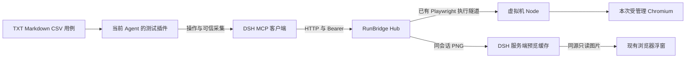

# RunBridge MCP 远程浏览器对接方案

[目录](README.md) · [能力差异](能力差异与改动清单.md) · [实施与验收](实施与验收计划.md)

## 目标与接入方式

为插件增加可选择的 RunBridge 浏览器后端，继续使用当前 DSH Agent、用例审核、工具审批、操作记录、可信采集和报告流程。浏览器在 Node 所在虚拟机运行；DSH 宿主连接 Hub，业务页面地址从虚拟机网络解释。

推荐通过 DSH 原有 MCP 客户端接入 Hub `/mcp`，将本地服务命名为 `runbridge`，得到 `mcp__runbridge__browser_*` 工具。测试插件适配这些工具并管理本次会话；操作仍经同一 Agent 的 `agent.ctx.tools.execute()` 派发。DSH 的已发布 MCP 客户端 `0.2.1-alpha.1` 已有 `streamable-http`、`url`、`headers` 配置，发布包内容已核对，因此首期没有修改 DSH 核心传输的必要。真实协议协商和工具图像投影仍需联调。[MCP Streamable HTTP 规范](https://modelcontextprotocol.io/specification/2025-11-25/basic/transports)

图中的 RunBridge 插件适配和预览缓存扩展属于拟议改动。Hub 到 Node 的启动、操作与释放链路已在服务项目实现。

## 方案比较

| 路线                                    | 对用户目标的覆盖                                 | 改动与取舍                                                                               |
| --------------------------------------- | ------------------------------------------------ | ---------------------------------------------------------------------------------------- |
| 配置 MCP 后直接更换服务名               | 原始 MCP 工具可被 Agent 发现                     | 插件仍固定使用 Playwright 工具、返回格式和本机预览，不能完成可信测试交付                 |
| 新增 RunBridge 后端并使用 MCP 截图      | 基础远程用例、程序断言、释放、运行画面刷新       | 插件改动为主；现有 12 个工具限制覆盖范围，等待中的截图可能排队                           |
| RunBridge 后端加 Hub 持续采集           | 运行中持续查看同一受管理页面，补齐批准范围的回归 | 需要扩展 Hub 的采集与画面来源；Node 协议能否保持不变由前置探针确认                       |
| 让现有 Playwright MCP 连接 Hub 原生入口 | 有机会复用更多既有操作与采集                     | 需要额外会话桥和原生连接管理，继续依赖 Playwright MCP；作为现有 MCP 工具缺口过大时的备选 |

推荐第二条作为最小闭环，再推进第三条。现有 Playwright 后端保留为可选项，运行开始时冻结所选后端；中途不切换到另一个浏览器来掩盖失败。未来是否移除旧后端，应在选定回归通过后决定。

## 配置与凭据

复用 Node 签发的私有访问文件作为唯一连接来源。它已有 `hub_url`、`node_id`、`grant_id` 和 `access_token`。插件拟增加 `browserBackend=runbridge`，以及 RunBridge 配置中的 `mcpId`、`accessFile`、`resourceId`、`leaseSeconds`；`mcpId` 选择已有 DSH MCP 实例，避免根据相同 URL 推断配置归属。

| 项目             | 配置来源与用途                                                        |
| ---------------- | --------------------------------------------------------------------- |
| Hub 根地址与节点 | 私有 `accessFile`，服务端读取；工具只接受其中绑定的节点               |
| MCP 地址         | 从根地址生成 `/mcp`，保留代理路径前缀                                 |
| Authorization    | 从同一文件读取 `access_token`，仅加入发往已配置 Hub 的请求头          |
| 资源             | 显式 `resourceId`；不抢占 BUSY 资源，不把 `vm-chrome` 当成受管理资源  |
| 租期             | `leaseSeconds`，遵守现有 1–3600 秒和 grant 到期上限                   |
| 预览             | 复用现有预览开关；RunBridge 后端不要求安装 DSH 宿主的 Browscreen 命令 |

MCP 客户端的标准配置为 `serverName: runbridge`、`transport: streamable-http`、`url: <Hub>/mcp`、`headers.Authorization: Bearer <access_token>`。占位符用于解释配置，不是可直接运行的凭据。发布包没有核实出可直接使用的 `accessFile` 或秘密插值字段；实施时由插件按现有 `PreviewSetup` 的运行时配置注入方式，向明确选择的 MCP 实例注入 URL 和请求头，避免把假设的环境变量插值写成实际能力。

接入诊断只展示地址、节点、资源、工具可用性和到期状态。令牌不进入模型参数、对话、报告、预览 URL 或页面；Node 身份和登记凭据仍由节点所有者管理。运行中的连接来源冻结，替换访问文件在下一次运行生效。

## 本次浏览器的归属

插件维护 `DSH session → suite run → case run → remote session → page` 的绑定。远程资源引用至少保存 Hub 来源、节点、grant、资源、`session_id`、`page_id`、`expires_at`，并写入可用于恢复的脱敏运行记录。凭据继续留在本机私有配置。

第一次进入已批准的浏览器步骤时，插件通过受信子调用执行 `node_inspect` 和 `browser_start`，检查 ACTIVE、节点、资源、grant 归属和返回句柄，再登记资源。纯接口用例不启动浏览器。每个用例实例使用独立远程会话，实例内准备、业务和收尾共用该会话；CSV 展开后各实例不复用前一个实例的登录状态。

模型从当前页面的真实快照决定定位和下一个动作。`test_execute_operation` 继续要求面向用户的操作说明，接受所选后端的完整工具名；插件补入当前资源的会话和页面参数。模型自行提供其他 ID 时拒绝，不允许通过原始 MCP 调用绕过当前步骤或后端门禁。

原生观察工具若仍要求显式 ID，可从 `test_current` 得到本次句柄，但必须经过相同归属校验。操作入口、直接观察、可信采集和恢复使用同一份映射与校验规则，不能只在封装操作入口检查身份。新窗口由 `browser_status` 返回页面目录；明确选页后才更新操作和预览绑定，不能自动按页序猜测。

## 可信采集与结果

RunBridge 返回 JSON 文本及 `structuredContent`，与 Playwright MCP 的 `### Result` 文本格式不同。适配层优先验证结构化内容，缺省时解析规范 JSON 文本；错误和截断不能被包装为成功观察。[MCP 工具结果规范](https://modelcontextprotocol.io/specification/2025-11-25/server/tools)

首期可用 `browser_read` 读取表单值和可见文本，用 `browser_snapshot` 读取地址、标题，再保存原始返回、调用 ID、会话、页面和采集时点。当前 DOM 文本合同是 `textContent.trim()`，RunBridge 使用 `inner_text()`，两者可能因隐藏文本与空白产生不同结果；需要显式标明采集语义或补齐固定只读采集接口，不能悄悄把既有断言换成另一种实际值。

当前 `browser_read` 不返回页面 URL，也不原子校验允许来源。仅使用现有工具时，采集前后的 URL 检查只能提供保守判断，页面跳转或检查不一致时拒绝绑定实际值。需要保持原有同次采集的来源保障时，应使用下面的固定采集接口。

要保持现有全部 DOM 采集模式，推荐 Hub 增加受限的 `browser_capture`：接受固定采集定义和允许来源，内部执行预定义只读采集逻辑，不开放模型任意脚本。保持 `text/number/count/visible/url/attribute/value`、索引、唯一匹配、缺失值和 href 路径解析语义。详细字段与验收见能力差异页。

页面动作完成、等待命中和截图可显示都不自动产生 PASS。PASS 继续来自冻结预期、完整可信实际值和插件的确定性比较。截图辅助定位与报告，不替代字段采集；采集来自错误页面、超限截断或未完成释放时不得给出完整通过结论。

## 运行画面

### 首期使用同会话 MCP 截图

在服务器维护独立的只读预览任务，用同一 access grant 和绑定的 `session_id/page_id` 调用 `browser_screenshot`。如 DSH 已发布客户端没有公开的后台原始调用入口，使用与其版本兼容的官方 MCP 客户端建立只读 HTTP 连接；该连接仅用于截图，不新建浏览器、不连接原生 SDK 入口。多个 MCP HTTP 请求访问同一授权会话与第二个 Playwright 原生客户端是不同机制。

建议从每秒一次刷新开始，单个请求在途时不叠加请求，有业务操作在途时降低频率。后台预览不经过业务操作记录器，也不把每帧注入模型上下文或完整报告；正式断言截图仍通过原生工具调用保存为证据。

从 MCP 原始结果的 `ImageContent` 解码 PNG，检查格式、大小和资源代次，缓存最新一帧。复用 `/test-progress/<DSH session>/<run>/screenshot` 与当前浮窗；MCP 自带截图没有远端采集时间，页面须标作“周期截图”，显示插件收到或请求图片的时点，不能伪造连续流帧号和采集时间。

当前 Hub 对同会话页面操作使用一把锁，`browser_wait_for` 可持锁 30 秒，截图也要等待。因此首期不能承诺等待期间画面持续刷新。超过新鲜度阈值时清空旧图并显示等待状态；预览失败不修改业务断言，但也不能显示另一页或上一轮画面。

### 持续画面优先复用 Hub 已有 Page

现有 `WS /v1/sessions/{session_id}/visual/stream` 的授权、状态与 PNG 二进制封包可以继续作为消费者接口。需要新增受管理浏览器的画面来源，并使选择的画面目标准确对应 MCP `page_id`。目前 `VisualService` 的支持判断、上传归属和选页都绑定 Chrome Node 上传通道，不能只删除 `UNSUPPORTED_BACKEND` 检查。

推荐先探测：由 Hub 持有的同一个 Playwright `Page` 建立只读 `CDPSession`，定时 `Page.captureScreenshot`，独立于普通工具操作锁，将有界 PNG 发布到会话画面缓存。公开 SDK 提供从现有 Page 创建 CDP 会话、发送命令和订阅事件的接口；是否能在远程受管理 Chromium 等待与导航中稳定采集，仍以固定 1.63.0 的探针为准。[Playwright CDPSession](https://playwright.dev/python/docs/api/class-cdpsession)

该路线预计只需要插件和 Hub 的代码改动，Node 继续传递现有原生消息；画面与操作仍共享底层执行隧道，不能宣称带宽完全隔离。若实测无法满足等待期间刷新或影响动作延迟，再采用 Node 为本次自建浏览器提供专用回环 CDP 的方案，并评审 Node 采集与清理改动。不要增加第二个 Playwright connect 客户端来寻找执行页：服务已有探测中，第二客户端看到 0 个 context 和 0 个 page。

Hub 将受管理来源与 Chrome Node 来源分开校验，复用最新帧、慢消费者队列、目标切换与陈旧状态处理。受管理目标可使用不透明 `page_id` 作为流的 `target_id`，同时在返回中明确页面映射，不让调用方推测 CDP target。

DSH 服务端按绑定的会话查询 `visual`、订阅 WS、移除二进制消息的长度和元数据头，核对会话、资源、连接代次、目标、流和递增帧序。访问 token 留在 DSH 服务端；浮窗继续请求已授权的 DSH 同源图片，无需直接跨域连接 Hub。页面切换、断流、取消和结束立即失效缓存，迟到帧不能重新激活旧画面。

## 收尾与异常

`browser_stop` 的 HTTP/MCP 调用成功只表示返回已取得。插件还必须核对返回会话就是本次会话，且 `state=CLOSED`、`cleanup=COMPLETE`；PENDING、UNKNOWN、INTERRUPTED 或错误响应保持未确认状态。必要时通过 `browser_status` 查询，不能用 `isError=false` 直接替代释放证据。

取消沿用现有停止准入、在途结算和冻结清理；释放调用不应被普通页面操作锁阻塞。插件保存远程资源后，设置页恢复流程也按后端释放已记录的会话，不能继续调用本机 `mcp__playwright__browser_close`。许可失效、Hub 重启或 Node 断线而无法证明收尾时保留隔离，交由所有者处理，不自行创建新浏览器来继续旧用例。

启动响应丢失时也不能盲目重试 `browser_start`。记录启动前同 grant 的会话列表并串行启动；响应未知时查询差异，仅在能唯一确认本次创建归属时采用句柄或释放。若同 grant 存在其他调用方而无法归属，应报告结果未知；完整交付可在 Hub 为启动增加请求幂等标识，作为明确的合同扩展，而非假定现有工具已经支持。

默认租期 300 秒不适合所有长用例。实施时为每实例设置明确租期并显示到期时间，超出租期或 grant 到期时停止当前实例。续租目前未实现；不通过周期性重新启动浏览器模拟续租。RunBridge 首期没有录像、回放和操作指针能力，预览开关与录像开关不能被当作同一能力；远程录像另行评审。
