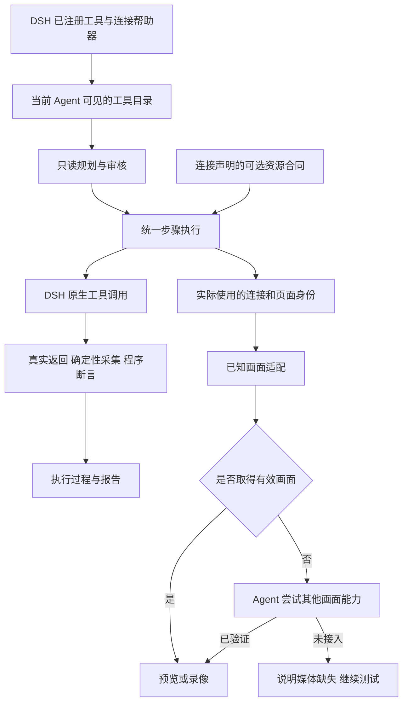

# 工具接入与实时画面统一方案

状态：用户已批准，已在独立尝试分支实施，按用户选择保留未通过的模型场景交付。日期：2026-11-01。设计基线：0.18.0，提交 `53a30af`。后续验证已按用户最新要求调整为最旧、最新两个宿主，中间版本支持声明保留；下文保留设计时的问题和方案，当前实现及验证边界见 [0.19.0-alpha.1 验收](../project/0.19.0-alpha.1版本发布验收.md)。

建议将插件整理为三个职责：帮助接入工具、使用当前 Agent 的工具执行测试、连接实际测试页面的画面。Playwright、RunBridge 和自定义 MCP 进入同一套规划与执行流程；已知服务的适配只提供连接帮助、必需的资源管理及画面增强，不再决定测试使用哪一套运行逻辑。

## 一、目标与范围

用户已确认的原则：

1. Playwright MCP、RunBridge MCP 的接入功能用于帮助注册和验证连接，不能成为正式运行的准入条件。
2. 未主动适配的 MCP 和其他工具也由 Agent 尝试发现、验证画面接入能力。
3. Playwright 是可选 Web 自动化工具之一，与其他工具平等；可以主动适配它的实时画面。

本方案在这些原则下细化配置菜单、工具加载、规划执行、媒体发现、旧配置迁移和验收方式。用户已批准按本方案实施，基于本地 main 创建独立尝试分支。复用现有通用工具目录、原生调用、结果提取、资源合同、预览和报告，不建设新的通用插件平台，不新增用户用例格式。

成功标准是：仅配置原生 Selenium 等未知 MCP 时，Agent 可以使用其真实工具执行和输出报告，并实际尝试它提供的画面能力；同时配置多种服务时，不因设置中的某个品牌选项排除其他工具，也不把另一个浏览器的画面接到当前测试上。

## 二、当前界面与代码的问题

### 配置流程观察

使用 Product Design 审查现有设置流程，在本轮本机 Web 界面拍摄并检查了以下三个状态。切换只发生在未保存草稿中；检查结束已放弃修改并恢复原配置，没有检测连接或申请设备。

| 步骤 | 观察与健康度 | 保留与调整 |
| --- | --- | --- |
| 1. 打开已保存的 RunBridge 设置，1440 × 900 | 部分良好。来源、凭据文件和只读检测说明明确；连接长表单占据首屏，画面和报告需要继续滚动寻找 | 保留私有文件和检测语义；详细字段移入对应连接的详情 |
| 2. 草稿切换为自动工具，1440 × 900 | 需要调整。上方说明支持任意工具，下方仍要求选择“Playwright 浏览器” | 去掉品牌绑定的全局画面来源，显示实际连接能力 |
| 3. 草稿切换为 Playwright，1920 × 1080 | 需要调整。“管理测试上下文”表现为独立运行模式；保存操作仍在较深位置 | 去掉运行模式选项；缩短表单，固定当前编辑区域的操作栏 |

截图和逐步审查保存在本机忽略目录 `artifacts/design/tool-connections-2026-11-01/`，其中包含本机配置路径，不纳入公开文档截图。截图可见长表单、灰色帮助文字和操作位置带来的阅读风险；键盘完整路径、读屏播报及色彩对比度仍需在实施验收中验证，不能仅凭截图认定无障碍达标。

### 代码中仍保留的耦合

0.18.0 已具备通用工具运行基础，但旧分支还没有完成统一：

| 位置 | 当前事实 | 本轮拟调整 |
| --- | --- | --- |
| `native-test.ts`、`browser-preferences.ts` | `backend`、`managedBrowser` 以及旧计划标志仍影响专用指导、资源创建与收尾；RunBridge 只在选择该后端时注册 | 连接登记与当前 Agent 工具共同进入统一目录，不按品牌切换主流程 |
| `tool-runtime.ts` | 已按当前 Agent 读取完整工具定义并保存摘要，主要 MCP 可改变排序 | 保留作用域和定义核验；去掉品牌或历史模式带来的默认执行偏好 |
| `preview-setup.ts` | 本机画面适配要求特定 Playwright 名称、启动方式；未知连接直接返回缺少画面接入 | 已知适配之后增加 Agent 发现与真实首帧验证 |
| 设置页 | “浏览器位置”同时控制执行、连接表单与媒体，自动模式仍显示 Playwright 专属字段 | 按工具接入、实时画面、环境与报告组织 |
| `adapters.ts`、`recovery.ts` | 旧 DOM 采集和无远程资源时的部分恢复仍回退到 Playwright 调用 | 使用实际绑定的工具及原资源身份，旧记录按原定义解释 |

只改菜单名称无法解决这些问题；在现有运行器外再增加一种“通用后端”也会继续维护多套执行路径。建议保留一套执行流程，把服务差异放回连接和能力层。

## 三、工具加载与统一执行

### 加载和规划

- 插件加载时注册测试入口、设置与连接帮助，不启动浏览器、不领取 Node。普通 MCP 的启用、进程和权限继续由 DSH 管理，插件不再维护另一套通用 MCP 加载器。
- Playwright 帮助器提供配置模板和连接验证；RunBridge 帮助器保留 Hub／现成访问文件及私有凭据处理。RunBridge 的目录读取和工具注册不再依赖全局 `backend=runbridge`，但读取目录仍不领取 Node。
- 规划读取当前 Agent 实际可见的完整工具定义，包含已授权 MCP 和宿主工具。已注册、已连通、当前对话可见分别表达，不能从全局设置推断当前 Agent 拥有权限。
- Agent 根据用例目标、工具说明和参数选择工具。没有默认 Playwright 优先级，不要求工具伪装成 Playwright 名称，不要求用户填写方法映射表。用户在用例中明确指定某项工具时仍尊重该约束。
- 规划／审核阶段不执行测试动作或媒体采集，不为检测画面创建页面或领取资源。需要当前页面才能确定的能力留到实际运行中验证。

### 执行和结果

所有业务操作通过同一个现有调用入口，按当前 Agent 的目录及定义派发。浏览器、接口和多工具协作沿用同一套步骤、原生权限、参数校验、取消、在途统计和报告规则。不能因先选择了 RunBridge 就禁止后续使用其他来源。

保留当前已实现的派发前定义冻结、动作返回复用、真实响应证据、严格类型提取和程序断言。Agent 负责选择工具和采集方法，不能补造实际值或宣布检查通过；媒体能力识别也不能修改业务检查和冻结预期。

工具或连接配置改变后重新核对，不能把旧调用悄悄转到另一连接。业务工具缺失时报告具体缺失能力，不能自动放宽预期、切换被测目标或强行启用 Playwright。

### 资源生命周期

资源管理依据连接声明和本轮真实资源身份，而非工具品牌：

- 普通 Playwright、Selenium 或其他外部服务默认由服务管理上下文，不自动执行 reset／close。确需插件管理资源时，使用现有可选资源合同，明确创建、身份、关闭及核对方式。
- RunBridge 继续通过宿主侧连接组件处理令牌注入和租约，将必需的创建／归还接入同一资源机制；只在本轮实际选用它执行浏览器工作时领取原 Node，不能因为已登记或查看设置就领取。
- 同批继续使用原节点租约，停止、失败和完成都等待原归还结果；UNKNOWN 保留隔离，不领取新令牌续跑。多来源协作时分别记录与收尾本轮拥有的资源。
- 不从 `--isolated`、工具名称或服务品牌推断本轮资源所有权；也不在缺少资源记录时默认调用 Playwright 关闭。

这里保留的是服务本身必需的连接语义，不保留品牌专属的任务指导、执行准入或替代断言逻辑。

## 四、配置菜单方案

保留 DSH 左侧“测试插件”入口，将内容标题改为“工具与实时画面”。顶部只保留一句说明：“Agent 按用例选择当前对话可用的工具；此处管理连接、画面与测试环境。”

采用三个页签，避免在单个长表单里同时展开全部服务参数。工具接入是默认页；若存在阻塞的待处理资源，在三个页签上方持续显示紧凑提醒及“查看并处理”入口。

| 页签 | 默认显示 | 次级操作与详细设置 |
| --- | --- | --- |
| 工具接入 | 已登记来源列表、连接状态、可取得的工具数、当前对话可见性 | 添加连接、检测连接、查看工具、编辑连接详情 |
| 实时画面 | 显示画面与录像两个独立开关；跟随实际页面；当前接入状态 | 让 Agent 尝试接入、重新检测；采集方式和依赖详情折叠 |
| 环境与报告 | 待处理资源、现有报告设置 | 原资源恢复、运行资料与维护信息 |

### 工具接入列表

Playwright、RunBridge、Selenium 和其他来源使用相同的两行列表项：第一行显示名称与连接状态，第二行显示工具及画面能力，右侧放“检测连接”和详情入口。没有品牌专用大卡片，不为 Playwright 增加默认推荐运行标记。

“添加连接”优先进入 DSH 已有 MCP 配置流程，并提供 Playwright、RunBridge 的便捷填写。普通 MCP 使用宿主现有配置；宿主若不提供直接跳转，则给出明确路径引导，不为此复制完整插件管理器。其他宿主工具只显示其可见能力及来源，不伪装成 MCP 连接。

RunBridge 的 Hub／访问文件、Node、租期和模板移入该连接详情，保持现有参数含义。打开详情、读取配置和检测连接仍只读，不领取设备。连接状态采用“已登记／检测中／已连通／不可达”；当前对话可见性单独显示。没有活动对话时写“运行时确认对话权限”，不显示虚假的工具可用结论。

取消全局“浏览器位置”和“主要 MCP”运行模式下拉框。多来源由 Agent 按任务选择；明确的工具要求放在用户任务中。保留连接名称和来源身份，避免多个同类服务只能靠品牌区分。

### 实时画面页

默认来源为“跟随测试实际操作的页面”，删除“Playwright 浏览器”必选字段。已有设置中的连接偏好只能作为能力发现线索，不能直接把画面绑定到另一个浏览器。

页面优先呈现：

1. “显示实时画面”和“录制操作视频”，沿用两个独立开关。
2. 当前来源、实际页面和已验证能力；还没有测试页面时显示“等待测试打开页面”。
3. “让 Agent 尝试接入”及简短结果；无已知适配也提供这个入口。
4. 展开后查看检测依据、失败原因、采集依赖和技术参数。

建议采用以下状态文案：

| 状态 | 展示含义与操作 |
| --- | --- |
| 未检测／等待测试页面 | 可读取能力信息；有页面后再验证首帧 |
| Agent 正在尝试接入 | 显示正在检查的来源，可停止尝试 |
| 持续画面已连接 | 已验证当前页面的连续画面通道 |
| 定时截图已连接 | 明示刷新间隔，例如“每 2 秒刷新”，不冒充视频流 |
| 仅支持单次截图 | 提供“获取截图”，不标为持续实时连接 |
| 画面来源待核对 | 多页面或身份不足，提示选择或核对当前页面 |
| 当前未找到画面能力／接入失败 | 给出已尝试的方法及下一步；仍可执行用例和输出报告 |

录像按独立能力验证。只有截图能力的工具可以显示画面，但不能因此宣称支持录像；本轮不增加截图拼视频编码器。切换对话、来源或页面时清楚显示重连状态，不沿用旧的“已连接”。

### 保存和可读性

连接详情使用“保存连接”，媒体偏好使用“保存画面偏好”；分别显示未保存状态和检测结果，保存成功不代表连接成功。操作栏固定在当前编辑区域底部，避免被长表单推走；不得遮挡输入或焦点。保存只作用于下次测试，当前运行继续使用原连接和配置快照。

复用 DSH 现有字体、颜色变量、控件、焦点样式和间距。状态同时使用文字与颜色；检测和 Agent 尝试结果需要可被读屏感知。详细说明按需展开，原本清楚的私有文件提示、只读检测说明和放弃修改功能继续保留。视觉验收只使用 1440 × 900 和 1920 × 1080。

## 五、已知适配和 Agent 画面发现

### 统一接入顺序

1. 从实际业务调用取得当前来源及可取得的会话、页面、资源身份。
2. 查找该来源的已知画面适配，先复用已经存在的通道。
3. 未接通时，由当前 Agent 根据真实工具定义、连接状态和实际返回尝试其他能力。
4. 宿主验证画面内容、采集回执与来源，成功后才标记相应能力。
5. 无持续通道则尝试定时截图、单次截图；仍无能力则结束尝试并明确说明。

同一次测试可以用多个工具，但画面始终跟随当前实际操作的资源。另一来源只有能证明它操作或观察的是同一个页面时，才可作为媒体通道；不能因为已装 Playwright 就从其默认标签页抓图。

### Playwright 和 RunBridge 的主动适配

Playwright 适配根据实际连接、包和能力识别，不只匹配 `serverName=playwright`，改名的连接仍应可识别。复用现有兼容的 CDP／Browscreen 路径，优先接入当前页面；已有 CDP、扩展连接以及不支持 CDP 的浏览器分别检测，缺少媒体增强不能禁止工具执行。

需要启动参数或初始化脚本的增强，只能在受控、兼容的连接中准备，并在首个业务调用前完成和重新读取工具目录。若运行中才发现需要修改启动方式，提示下轮生效；不得重启共享浏览器或换一个浏览器来制造画面成功。不持久覆盖用户的 MCP 配置。

规划目录与最终执行绑定需要区分：若媒体准备会重启连接，先完成准备，再冻结最终工具定义；已经开始执行后不原地替换目录。这可以避免画面初始化使已保存的工具引用失效。

RunBridge 继续使用本轮原 Node、原会话和页面的持续画面能力，不为预览再次领取设备。两者的主动适配都只减少媒体连接失败，不为正式步骤增加品牌优先级。

### 未知 MCP 和其他工具的 Agent 尝试

Agent 使用当前对话已授权工具的名称、说明、参数和可取得的资源信息判断能力，不要求扩展字段齐全，也不只根据工具名含有 screenshot 就认定可用。发现顺序为：现成画面或图片通道、可接入的现成调试端点、返回真实图片的截图工具、单次截图。

尝试复用当前 Agent 的原生调用管线，保留权限、取消和调用身份，不创建一个绕过审核的后台 Agent。设置里的按钮将任务交给当前对话；没有活动对话或页面时显示所缺条件，不在设置服务中凭空执行工具。

每个候选先登记来源、工具及参数、结果提取位置、预期媒体类型和目标身份，再实际调用并验证：

- 必须取得可解码图片或受支持通道的有效首帧；模型文字描述和自行构造的 URL 不能作为连接成功证据。
- 核对实际采集回执、时间／序号以及页面归属；静止页面不要求图像内容变化。只有一张历史图片不能证明持续能力。
- 端点、参数和提取路径必须来自真实定义或返回。不猜端口、不安装驱动、不擅自改 MCP 启动命令，不把未知协议一概宣称为已支持。
- 多页面或身份不足时显示“来源待核对”，通过实际页面标识核对；不能按返回的第一个页面或相同 URL 直接认定归属。

建议每轮自动尝试限制为最多三个候选、总计约 30 秒，支持停止和手动重试，避免持续消耗模型轮次。这是实现默认值建议，不新增一组面向普通用户的预算配置。未知工具只返回单次图片时先提供单次能力；允许重复读取且验证来源后再提供定时截图。

设置检测与规划保持只读、不领取资源。画面验证等待正式运行创建实际页面；如果后续确有独立试连并创建页面的需求，应作为明确的试运行操作另行设计，不能藏在普通“检测连接”按钮中。

### 采集、缓存与报告

验证后由宿主执行已核对的采集方法，不让模型为每一帧重新规划。截图轮询采用低频、同一来源串行、最多一个在途采集，业务动作优先；来源改变、测试结束或没有预览／录像消费者时停止。关闭浮窗仍不停止独立录像。

可缓存方法与提取路径，并以连接和工具定义摘要校验；每轮重新解析会话、页面及临时地址，不缓存旧令牌或过期端点。敏感端点与授权信息继续留在宿主侧，通过私有引用交接，不写入普通设置、模型上下文或报告。

媒体尝试和轮询保存真实调用依据，归入媒体记录，避免把每帧采集填进业务实际步骤和手工用例。画面缺失或中断通常只降级媒体；若调用导致外部结果 UNKNOWN，仍遵循现有停止与隔离规则。需要画面作为业务断言依据时，按原检查条件处理，不能用“媒体可选”绕过业务失败。

## 六、旧配置和旧记录迁移

| 现有内容 | 迁移行为 |
| --- | --- |
| `backend=auto` | 使用统一工具目录，无需额外连接 |
| `backend=mcp` 与 `mcpId` | 保留连接身份供接入和诊断；不再排除、强制优先或依赖该来源才能启动 |
| `backend=playwright` | 转为已有 Playwright 连接及可用的媒体配置，不默认 reset／close |
| `backend=runbridge` | 转为已登记的 RunBridge 来源，保留私有文件、Node 与租期；实际使用时才启动原资源生命周期 |
| 原预览 `mcpId`、开关与命令参数 | 保留开关和可用参数；连接 ID 作为发现线索，必须与实际页面核对 |
| 格式 1 旧浏览器计划 | 保留目标、步骤及冻结检查，经兼容层解析为能力要求或显式原绑定，不再自动启用 Playwright 运行分支 |
| 已有运行、报告及恢复记录 | 按原记录解释和重建，不改历史结论；恢复只使用原连接、工具和资源身份，缺失时提示人工核对 |

迁移不重复登记相同 MCP、不覆盖用户自定义参数或凭据。首次打开时用一条可关闭说明解释：“原浏览器模式已转为工具连接，运行时由 Agent 按用例选择工具。”

旧计划中已经显式冻结的工具引用保留原约束，不能为了兼容而静默换工具。只有旧代码隐含的品牌假设需要去掉；无法确定对应能力时明确提示缺项。

## 七、实施落点与顺序

| 阶段 | 主要改动 | 通过条件 |
| --- | --- | --- |
| 1. 统一加载与执行 | `tool-runtime.ts`、`native-test.ts`、`runbridge.ts`：来源登记与资源处理脱离全局后端，移除品牌指导与排他分支 | 多来源可同时参与；单独 Selenium、Playwright、RunBridge 均走同一执行流程 |
| 2. 统一采集与收尾 | `adapters.ts`、`tool-resource.ts`、`recovery.ts`：旧 DOM 与资源操作绑定实际来源 | 无默认 Playwright 关闭；严格采集、原资源收尾与 UNKNOWN 规则保持 |
| 3. 媒体发现与降级 | `preview-setup.ts`、`preview.ts`、`runbridge-preview.ts`：复用已知适配，补 Agent 候选验证和截图模式 | 未知工具有真实尝试，来源正确，持续／定时／单次能力分明 |
| 4. 配置菜单与迁移 | 现有客户端设置组件、`browser-preferences.ts` 及配置读写：三个页签、来源详情、独立保存及旧字段迁移 | 没有运行后端下拉框；改设置不改变在途连接；两种规定尺寸通过 |
| 5. 完整交付 | 更新中英文当前使用文档、架构、截图和验收记录 | 同包全宿主、真实模型和 GitLab Markdown UI／接口验证后再按约定发版 |

模块按连接、执行、媒体职责整理，保留现有可用实现；只在职责确需独立时拆分文件。不新增一套第三方适配 SDK，不把每个未知工具做成固定厂商适配器。当前十版 DSH 支持集合与构建 SDK 不因这次整理而改变。

## 八、验收场景

| 类别 | 必须验证的结果 |
| --- | --- |
| 无已知服务 | 只有自行开发的原生 Selenium MCP，完成 Markdown UI 用例、程序断言、报告及手工 MD |
| 平等执行 | Playwright、RunBridge、Selenium 同时可见，Agent 按任务组合使用；无品牌优先级或设置造成的排他限制 |
| 更名与浏览器差异 | 更名 Playwright 仍可识别其可用媒体；无 CDP 的工具仍能执行，不强制换浏览器 |
| 未知画面 | 分别覆盖现成端点、标准图片返回、定时截图、仅单次图片、无图片、不可达和不支持的通道；保留真实尝试依据 |
| 画面归属 | 两个浏览器、多个页面、过期端点、切换实例及身份缺失时，不展示另一资源为当前测试画面 |
| RunBridge 租约 | 打开设置、规划和只读检测不领取 Node；实际使用才领取；全批原租约；失败／停止／UNKNOWN 正确归还或隔离 |
| 资源所有权 | 外部共享上下文不自动关闭；显式托管资源按原合同清理，连接变化不关闭新会话 |
| 结果可信 | 业务提取与冻结预期不因媒体探索变化；模型不能伪造连接成功或业务 PASS；原生权限与取消保持 |
| 兼容与报告 | 新旧计划、旧报告重建、旧隔离恢复；媒体记录不混入业务步骤和手工资料 |
| 设置交互 | 空列表、已登记但不可见、检测失败、Agent 尝试中、保存／放弃、运行中改配置；键盘、焦点及状态播报 |
| 视觉尺寸 | 仅 1440 × 900、1920 × 1080；检查首屏信息、操作栏、长名称／路径和详情滚动 |
| 正式发行 | 全部支持 DSH 宿主验证同一摘要安装包；受控真实模型和 GitLab Markdown UI／接口验收；确认 Agent 空闲、作用域关闭、在途归零 |

主要取舍是：增加一次按真实能力探索画面的成本，换取未知服务覆盖；优先复用已经验证的路径和绑定后的采集方法，控制这部分开销。未知工具可能只能提供截图或完全没有媒体能力，因此以实际验证结果表达能力，不承诺所有 MCP 都能提供视频流。

本轮方案审核重点是三项边界：连接登记不决定执行工具；画面跟随实际页面并允许 Agent 尝试；资源收尾依靠原连接和真实所有权。通过后按上述阶段实施，完成整体验收后再交付新版本。
