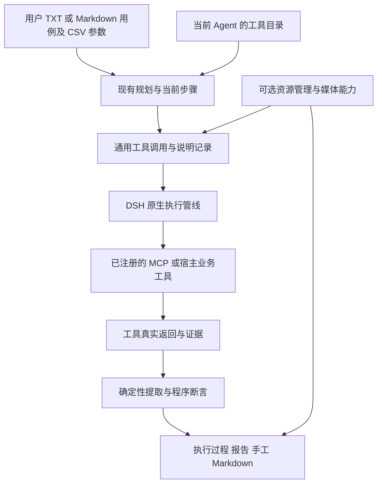

# 通用工具运行方案

状态：待审核，尚未实施。日期：2026-10-31。基线：插件 0.17.0。

测试执行改为使用当前 DSH Agent 可用的业务工具，取消 Playwright MCP 和 RunBridge 的固定后端准入。自定义 Selenium 或其他 MCP 保留原有名称、参数和返回格式，插件负责步骤推进、工具调用记录、实际值提取、断言及报告。Playwright 与 RunBridge 继续提供既有能力，不成为其他服务的接入前提。

本次范围覆盖通用工具调用、结果采集、资源收尾、报告与配置迁移。连接和工具注册继续交给 DSH，不增加 MCP 客户端、驱动安装器、并发调度器或新的用例文件格式。

## 当前限制与设计选择

[Selenium 实测](../project/自定义SeleniumMCP兼容性核验.md)已确认：原生 Selenium MCP 可以独立完成浏览器操作，但插件会调用不存在的 Playwright 关闭工具，并拒绝 Selenium 前缀；改为兼容现有工具约定后，同一插件包可以执行并生成通过报告。

| 限制位置                                 | 当前行为                                     | 改造方向                                            |
| ---------------------------------------- | -------------------------------------------- | --------------------------------------------------- |
| `browser-preferences.ts`、`config.ts`    | 后端固定为两个枚举值                         | 以可用工具和连接来源配置执行                        |
| `native-test.ts`、`actual-operations.ts` | 固定前缀、操作名单、浏览器专有指导与清理准入 | 从当前 Agent 工具目录生成调用范围，按步骤和用途记录 |
| `adapters.ts`、`contracts.ts`            | 采集类型及 DOM、截图、关闭调用绑定现有后端   | 增加通用工具结果采集，保留旧采集定义                |
| `recovery.ts`                            | 无远程资源时按 Playwright 推断恢复方式       | 使用本轮保存的资源归属与清理定义恢复                |
| `preview-setup.ts`、设置页               | 测试启动前处理特定 MCP 的预览接入            | 预览能力独立检测，缺少时仍可执行测试                |
| `manual-case.ts`、报告投影               | 部分输入补全依赖已知工具名                   | 通用操作和实参参与导出，专有格式化作为增强          |

主要有两种实现方式：逐个服务编写完整适配器，或建立通用调用与结果提取基础，再对专有能力提供增强。前者能精确处理单个服务，但每增加一种 MCP 都要修改插件。建议采用后者：具备可解析输出的普通 MCP 无需新增 TypeScript 适配器；RunBridge 租约、Playwright DOM 采集和 CDP 等特殊能力继续复用已有实现。

## 运行结构



### 工具发现与步骤绑定

从 `agent.ctx.tools.schemas()` 和 `get()` 读取当前可用的完整工具名、说明和参数 Schema，按实际注册名称派发，不再匹配 `mcp__playwright__`、`mcp__runbridge__` 或 `browser_*`。例如 `mcp__selenium__browser_click` 与 `mcp__webdriver__click_element` 均可参与执行。

基础发现只依赖已有 DSH SDK 的工具名、说明和参数。当前构建 SDK 的 `ToolSchema` 没有完整暴露 MCP `annotations` 和 `outputSchema`，不能把这些字段设为通用运行的必备条件。可取得时将其作为辅助信息；工具注解不能单独证明只读、幂等或无副作用。[MCP 工具规范](https://modelcontextprotocol.io/specification/2025-06-18/server/tools)也将注解与实际结果分别定义。

规划阶段只读工具目录，不执行业务工具、不启动浏览器、不领取 Node。进入当前步骤后，模型结合目标和真实工具说明选择操作与查询工具；不要求用户为每个方法填写映射表。运行记录保存工具名、参数定义摘要、连接来源及可取得的上下文身份，后续调用核对相同定义，避免重连后继续使用另一份工具或会话。

排除递归调用测试控制工具及改变插件运行状态的管理入口。其余业务工具沿用当前 Agent 的可见范围和宿主权限。多来源工具可以在一个用例中协作，浏览器上下文和资源身份分别记录，不因服务品牌不同而拒绝。

### 通用调用与操作记录

扩展现有 `test_execute_operation`，从目录生成可选工具名称，保留 `description`、`arguments`、`arguments_json`，增加调用用途 `action`、`observe`、`cleanup`。用途说明调用目的，不作为该工具无副作用的证明。

执行阶段的业务调用统一由此入口或 `test_capture` 转交。观察调用归入运行依据，动作进入实际步骤，清理进入收尾；不再依赖工具名称猜测这三类记录。失败尝试、未派发、在途和未知状态继续保存。没有可靠原子粒度声明的自定义工具标为“粒度未确认”，不把任意脚本自动视为单个已证实动作。

底层复用现有 `NativeTest.call`：通过同一 Agent 的 `tools.execute`，保留父子调用身份、原生审批、参数验证、取消信号、超时及错误返回。既不绕过宿主权限，也不增加插件专属的逐工具人工确认。串行执行与现有停止收尾机制继续沿用。

以下为待实施接口示意，名称和参数均为上一轮原生 Selenium 服务的真实定义：

```js
test_execute_operation({
  description: "点击‘增加 1’按钮",
  tool_name: "mcp__selenium__browser_click",
  arguments: { selector: "#increment" },
  purpose: "action",
});
```

## 实际值采集与断言

### 通用采集定义

在现有 `dom`、`http`、`browser_open`、`browser_close` 之外增加 `tool` 采集。定义包含实际工具名、调用参数、返回来源、字段路径及显式类型转换。文字用例在当前步骤按现有运行时定义机制生成；内部固定计划在执行前给定。

```js
test_capture({
  reason: "读取页面当前计数",
  capture: {
    counter: {
      kind: "tool",
      tool_name: "mcp__selenium__browser_read",
      arguments: { selector: "#counter" },
      extract: { from: "structured", pointer: "/text", type: "number" },
    },
  },
});
```

该服务返回 `structuredContent: { text: "1" }` 时，由程序提取并转换为数值 1，再与用例中已冻结的预期比较。模型只选择采集方法和规则，不能提交实际值或声明断言通过。采集定义在相应调用派发前保存，解析失败不得根据已返回的值反复改规则直到通过。

同一套提取器也可处理动作本身的返回：先在动作派发前登记输出路径，再绑定该次调用的已结算结果，不为获取响应而再次执行写操作。复用结果必须核对同一运行、实例、步骤和调用身份，禁止从其他用例或旧尝试取值。

### 返回格式与提取规则

| 返回形式                        | 处理方式                                                   |
| ------------------------------- | ---------------------------------------------------------- |
| MCP `structuredContent`         | 从指定 JSON Pointer 取值；可取得输出 Schema 时一并验证     |
| DSH 原生工具的结构化 `value`    | 从指定路径取值，保留完整来源                               |
| MCP 纯 JSON 文本或 JSON 代码块  | 按已声明的文本块及格式解析，不扫描并挑选有利片段           |
| 普通文本                        | 可提取全文或预先定义的固定分隔片段，并做严格类型转换       |
| 图片及附件                      | 按原有证据规则归档；图片本身不能自动成为结构化断言的实际值 |
| Playwright 旧 `### Result` 返回 | 由内置兼容解析器继续处理，不要求自定义服务使用此包装       |

规范化时同时检查 DSH 管线错误和 MCP 内层 `isError`，不能因传输成功而把工具失败当成成功。保留原响应、提取定义、字段路径、调用 ID 与证据摘要，使离线重放能够重算断言。

通用采集记录独立的 `tool-result` 来源，不沿用固定 DOM 适配器的来源标识。采集绑定必须包含当前检查对象、所用工具和实参；插件控制工具或模型直接提供的数值不能成为实际值。对于任意服务，程序能验证调用与提取链，无法普遍证明工具返回的业务含义；这一边界在采集依据中保留，已有固定 DOM 适配器的校验继续生效。

稳定输出不存在或文本含义不能确定时，报告为未得结论；工具缺失、失败、超时及响应格式错误记录为执行异常。实际值与冻结预期不符记录为 FAIL。所有必需检查均须有有效结果，不能把“动作执行成功”代替 PASS。缺少某项能力影响对应步骤及其依赖，不在运行入口要求所有服务具备完整浏览器能力。

## 资源初始化与收尾

取消“浏览器步骤必先关闭 Playwright，再追加 Playwright 关闭步骤”的通用默认行为。MCP 并不统一要求服务提供创建、重置、关闭或状态查询；资源处理由实际接入能力及归属决定。

| 资源归属                                 | 初始化与收尾                                                           |
| ---------------------------------------- | ---------------------------------------------------------------------- |
| 本轮明确创建并拥有的资源                 | 保存创建来源、身份及清理绑定；结束、停止和失败时执行对应清理，核对结果 |
| 用户提供的现成会话或服务自行管理的上下文 | 不默认重置或关闭；执行用户用例中的收尾，并在报告标明管理责任           |
| 已发出创建请求但结果未知                 | 保存原请求和工具身份，查询原结果或隔离；不换工具重建并重放写操作       |
| 没有资源分配行为                         | 不生成虚构的初始化和关闭任务                                           |

本轮拥有资源的判断来自接入配置、受信的连接作用域及真实创建结果，不能由模型一句“已创建”或“已关闭”确认。可选资源绑定只描述启动、状态、关闭工具以及结果字段和连接作用域，无需修改自定义服务为 Playwright 协议。若服务无法给出本轮资源的准确身份或作用域，默认按外部管理处理，不声称插件已经释放它。

缺少关闭能力本身不阻断外部管理的上下文运行；报告明确显示“由外部服务管理”，而非“已归还”。用例明确要求干净会话、自动回收或隔离环境时，相关能力成为前置条件，缺少则阻断该用例。已由插件接管且尚未确认释放的资源继续执行现有隔离规则，不能通过改成外部管理来消除未结责任。

RunBridge 继续在其资源管理实现中保留 Hub 领取、原 Node 整批共用、续租、请求恢复、归还和 UNKNOWN 隔离。Playwright 继续保留现有上下文生命周期。通用层调用这些能力，不把两者的协议写入其他服务的执行规则。

恢复时读取原运行冻结的资源、连接和清理定义，不能把无 `node_lease` 的所有记录推断为 Playwright。无法恢复原身份时保留已有人工处置入口。当前全局串行和隔离范围不在本次改造中扩大为多任务调度。

## 截图预览与报告

截图、持续预览和录像独立于基本执行。工具已经返回图片时直接归档；需要单独截图且存在相应能力时调用所绑定的截图工具。没有截图、CDP 或录像能力时仍可输出步骤、工具响应和断言报告，不调用不存在的默认工具。

预览接入只对已知且兼容的连接应用原有启动参数。自定义服务不被自动重写命令、注入 Playwright 初始化文件或因预览检测失败而禁止测试。设置页显示各项实际能力及不可用原因，预览和录像开关仅影响对应能力。

报告继续分别表达业务结论、操作记录完整性和资源收尾状态，增加工具来源及能力缺项的运行依据。原始工具响应保留在技术详情中，不堆入主要操作步骤。不同服务使用相同执行过程布局，不再出现两套报告入口。

手工用例继续使用既有五部分结构。通用工具的成功动作以派发前说明和实际参数中的业务输入生成步骤，真实数据及地址合并到操作中；已知工具的专有补全保留为可选格式化，名单以外的动作不能丢失。观察调用、工具名、调用 ID、执行状态和技术定位不混入手工资料。预期继续来自原检查，不能从实际响应反推。

## 设置与旧数据迁移

复用现有浏览器连接和 MCP 选择设置，将面向用户的执行来源调整为：默认自动使用当前可用工具、按需指定主要 MCP 实例，以及已有 RunBridge 连接。自动模式不新建服务、不安装驱动；多个工具可按步骤目标协作，只有缺少影响业务选择的信息时才追问用户。

已有明确保存的 Playwright 配置解析到其已启用 MCP 实例，RunBridge 配置保留原来源、私有文件和租约参数；仅使用旧默认值且没有显式选择的配置采用通用自动模式。现有 `mcpId` 继续参与连接选择和预览定位，避免要求用户重复填写。无法确定旧配置对应实例时给出具体提示，不能悄悄换成另一个已有会话。

旧 `browser`、`api` 步骤及四种采集定义继续执行，新增通用工具能力与采集类型。新定义使用明确的计划格式版本及运行能力版本；旧计划按原格式解析并在执行时转换，旧报告按原账本重建，不回写历史计划。历史 `browser_context` 继续读取，新资源记录补充来源、归属和清理绑定，避免新版本按浏览器品牌猜测旧状态。

TXT、Markdown 和 CSV 用户入口不变。新增字段和完整调用合同只在开发文档中说明，不要求用户编写内部 JSON。

## 实施步骤

| 阶段                 | 主要修改                                                                                                  | 完成条件                                                                        |
| -------------------- | --------------------------------------------------------------------------------------------------------- | ------------------------------------------------------------------------------- |
| 1 通用调用与采集     | 新增工具目录与派发模块、结果提取模块；调整 `contracts.ts`、`adapters.ts`、`native-test.ts` 和实际操作识别 | 原生 Selenium 名称和普通 MCP 返回可执行、采集、断言，不依赖 Playwright 工具存在 |
| 2 生命周期与恢复     | 调整初始化、清理、资源记录及 `recovery.ts`，接入现有两个后端能力                                          | 外部上下文无强制关闭，本轮资源有准确清理证据，停止与未知结果不重放              |
| 3 设置及交付资料     | 调整现有连接和媒体设置、实际步骤、手工导出、报告与中英文说明                                              | 新旧配置兼容，能力缺项不误导，手工文件不丢动作与真实业务输入                    |
| 4 同包验收与版本交付 | 完成矩阵、真实模型及 GitLab 回归，按现有发布约定递增版本并打本地附注标签                                  | 同一候选包全部通过，先本地提交和标签供审核，推送沿用用户授权流程                |

各阶段共同构成完整交付，不在仅删除前缀检查或只跑通动作时声明通用运行完成。实现按职责增加少量模块，复用当前执行管线和比较器，不建立插件市场或要求每个服务另写一套完整驱动。

## 验收标准

1. **原生 Selenium 正向验证**：沿用已开发的真实服务 `native` 模式，禁止兼容别名；宿主既没有 Playwright MCP，也没有 RunBridge 工具。通过 Markdown 用户入口完成导航、点击一次、读取 `#counter`，固定预期为 1，并生成 HTML、图片证据、实际步骤与手工 MD。
2. **工具名称不作准入依据**：增加一组没有 `browser_*` 方法名的等价服务，例如 `go_to`、`click_element`、`get_text`；改变 MCP 实例名及参数字段后，依照真实 Schema 仍可执行，无需修改插件工具名单。
3. **返回与错误覆盖**：验证结构化响应、纯 JSON 文本、普通文本、图片、内层 `isError`、字段缺失、类型不符及固定反例；不得把缺失观察或错误包装为通过。旧 `### Result` 返回继续可用。
4. **资源边界验证**：覆盖本轮新建、外部现成上下文、无关闭能力、关闭失败、创建结果未知、取消及重启恢复；只清理原资源，不调用不存在的 Playwright 关闭工具，不把外部管理写成已释放。
5. **记录与反伪造验证**：检查失败重试、未知粒度、跨步骤或跨实例取值拒绝、提取规则事后改写拒绝、修改预期拒绝及写操作不重复执行；账本重放重算相同断言，手工资料保留业务输入并排除观察和技术来源。
6. **已有能力回归**：真实 Playwright、RunBridge 生命周期及原 Node 租约、纯接口、混合用例、审核、停止、预览和录像按现有约定验收。可选媒体缺失只影响媒体，用例明确要求的能力缺失则阻断相应用例。
7. **DSH 与发布验证**：保留当前全部十个支持宿主，使用同一候选包完成确定性矩阵，并按[多版本验证](../deployment/DSH多版本验证.md)完成受控真实模型和 GitLab Markdown UI／接口验收。每轮报告后确认 Agent 空闲、作用域关闭、在途工具归零。涉及设置和报告界面的视觉验证仅使用 1440 × 900、1920 × 1080。

## 主要取舍

通用接口会把选择工具与定义采集路径的工作交给模型，服务描述质量会影响执行稳定性。程序能够证明实际值来自哪次调用、怎样提取及如何比较，不能仅凭工具名称证明服务内部执行的动作。输出含义不清时保持未得结论，不能让模型直接填写 PASS。

具备稳定结构化输出的自定义 MCP 应做到无需专用代码接入；特殊租约、二进制传输或恢复协议仍需要对应能力实现。将这类增强保留为可选项，使简单服务可直接运行，也使现有 RunBridge 的严格资源语义得以保留。

所有步骤结果最终按统一状态规则聚合。必需业务检查、明确要求的清理或环境前置条件未满足时不能整体 PASS；服务的可选能力缺项和外部资源管理责任分别展示，不伪造成功或无故判为异常。
