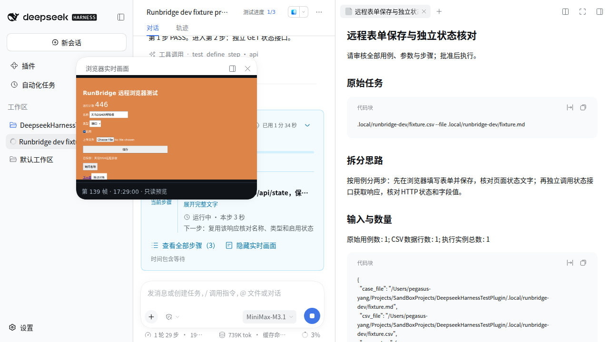
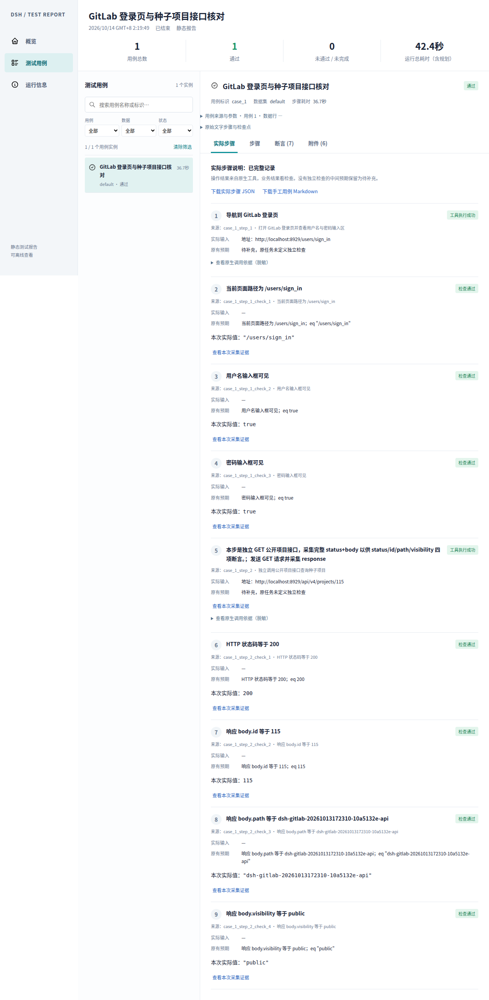

# RunBridge 远程浏览器接入验收

[文档导航](../README.md) · [使用指南](../user-guide/RunBridge远程浏览器与持续预览.md) · [架构](../architecture/RunBridge远程执行与画面.md)

日期：2026-10-14（Asia/Shanghai）。交付版本：插件 0.12.0、Hub/Node 0.5.0；公开 DSH 与 MCP 工具投影 SDK 0.2.1-alpha.1、官方 MCP Client 2.0.0、Python MCP 2.3.0、Playwright 1.63.0。Hub 在 macOS，Node 与浏览器在 Ubuntu ARM64；Node.js 22.22.3、Python 3.14.4、Google Chrome for Testing 153.0.8010.12。

## 验收目标与实现

当前 Agent 通过远程 MCP 完成正常浏览器用例、固定实际值采集、原生审批和操作记录；同会话、同页的持续 PNG 经插件同源路由显示。接口用例在宿主执行 GET，不申请浏览器。每次运行冻结私有访问配置及身份，未知结果和未确认清理不得宣称完成。

Hub 的工具数从 12 增至 26，支持唯一定位、原子输入/点击/按键/选择/勾选/悬停/拖拽/滚动、回退/视口、多页/frame、弹窗、字节上传、DOM 检视及固定 DOM 采集。Node 验证实际 CDP PNG 能力；Hub 在 MCP 已持有的同一 Page 上采集，不用第二个执行连接寻找页面。

## 自动回归与产物

- 插件：29 个文件、330 项单元/集成测试通过；TypeScript、dist 构建和入口清单通过。新增身份注入、默认列页、UNKNOWN、终态 COMPLETE、原请求恢复、原许可归属、JSON 字符串数组转交、原图证据和过期/旧帧撤下验证。
- Hub：76 passed、6 skipped；跳过受限 macOS 的真浏览器场景。新增单次启动、取消后核对、最后一页关闭后新建、来源和定位校验、采集不争用工具锁、瞬时失败恢复。
- Node：31 passed、19 skipped；真实浏览器路径在 macOS 显式关闭，在 Ubuntu 单独验证。短私有 TMPDIR 的权限、长路径和 COMPLETE/UNKNOWN 清理边界通过。
- Hub/Node 0.5.0 的 wheel 与 sdist 构建完成。插件安装包及最终本地提交/标签核对随交付更新；不推送远端。

## 真实协议、浏览器与画面

官方 MCP Client 发现 26 个工具；同 request_id 重复启动只返回一个会话，关闭后仍可按原请求核对。实际表单、选择、勾选、按键、悬停、保存、固定 DOM、弹窗、iframe、文件上传及拖拽完成，另从虚拟机接口核对状态。4 秒等待期间接收 23 个帧包、12 张不同 PNG；包统计含状态通知重发的同编号缓存帧，不能解释为 23 次独立采集。

三次页面绑定均收到正确目标的 PNG；所有页面关闭后能再次 new。瞬时截图错误会撤下旧图，成功后恢复本任务的流和页面，不能永久卡在 CAPTURE_FAILED。真实截图完成图像查看，中文、输入、上传文件名、弹窗及拖拽结果可读。停止确认技术终态与 Node cleanup=COMPLETE，资源恢复 READY/FREE。

## 原生 DSH 与已保留的失败

通过独立公开 DSH 宿主的普通输入框运行 Markdown/CSV。运行记录位于不提交的 `.local/runbridge-dev/dsh-runs/`，服务配置、许可、日志和原始用例均保存在私有目录；不复用用户旧 Chrome 的 profile 或登录，也不关闭原有 Hub/Node。

| 运行                                                                  | 结果与证据                                                                                                                                              |
| --------------------------------------------------------------------- | ------------------------------------------------------------------------------------------------------------------------------------------------------- |
| CSV 首轮 `run-2026-10-13T17-27-25-559Z-2518153c`                      | 五项业务检查完成，但嵌套数组转换及终态判断造成失败，封存 ERROR/隔离；没有改写成 PASS                                                                    |
| CSV 复测 `run-2026-10-13T17-37-52-141Z-e3395b3b`                      | PASS；页面状态、HTTP 200、名称、api、enabled=true 五项程序断言，独立接口核对，截图证据及释放通过                                                        |
| GitLab Markdown 首轮 `run-2026-10-13T17-45-50-634Z-de22a349`          | 2 UI、3 API 实际运行；4 FAIL、1 PASS。页面检查与释放成功，四项长度检查误引用整个数组；独立响应证明该数组长度符合种子预期，不能据此把账本 FAIL 改成 PASS |
| GitLab 审核尝试 `run-2026-10-13T18-01-25-922Z-c6b7456e`               | 长 review_markdown 未通过精确匹配；未执行业务。达到本轮验证时限后封存，通过 Node 空闲与原 grant 无会话证据处置，旧记录保留                              |
| 发行包 GitLab 小规模 Markdown `run-2026-10-13T18-19-49-721Z-031f1b27` | PASS；远程登录页路径与用户名/密码框可见，宿主 GET 及项目 id/path/public 共 7 项断言；独立 GET 核对、Node COMPLETE、1200 秒配置实际生效                  |
| GitLab 直接执行复测 `run-2026-10-13T17-55-58-826Z-7ce5df4b`           | ERROR/CANCELLED；模型未满足原有计划通报守卫，未执行业务。模型说“没有报告”不作为事实，账本已生成真实报告                                                 |

已在设置页按原访问文件确认并释放首轮遗留会话，保存处置证据；旧 ERROR、资源记录和报告保持原样。浏览器位置、访问文件和预览开关显示正确；普通可编辑 profile 保存租期 1200 秒，刷新后仍为 1200。命令行 overlay 的保存限制也由页面明确提示。

截图来自首轮 CSV 的业务执行阶段；该轮后续清理问题与最终 ERROR 已在上表记录。

真实浮窗已经显示同一远程页面的持续画面；关闭观看不终止执行，正常结束或隔离后撤图。发行包通过公开 DSH CLI 安装并运行，95 个 dist 文件与构建逐字节一致。profile 中所有入口均核对为包名，避免本机 file: 覆盖使验收仍加载源码。安装时 SDK peers 由宿主提供，单独对 profile 运行 pnpm peers check 会报缺失，真实宿主加载与本轮运行正常。

静态报告在真实远程浏览器打开，实际值、预期、通过状态及手工步骤可见；原生报告与账本一致。

完整的版本、源码哈希与收尾记录见[交付核验记录](RunBridge远程接入核验记录.json)。

## 支持边界

替代范围为本插件正常操作、可信采集和生命周期。远程视频、历史回放、任意 evaluate/run_code、下载/网络拦截与全部 Playwright SDK 方法未交付。本轮不认证 Windows、公网 TLS/NAT 或容量压力。模型误绑定和通报失败独立于远程协议；所有失败保留，不用点击成功、截图或进程退出码代替业务 PASS。
