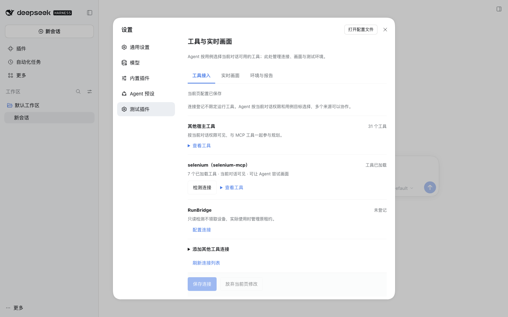
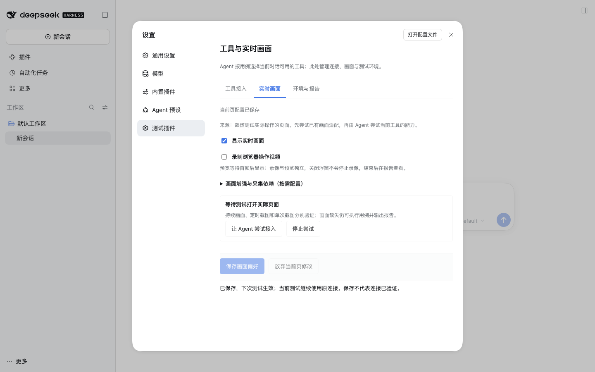

# 浏览器实时预览一步一步配置

[项目首页](../../README.md) · [通用工具运行](通用工具运行.md) · [安装与运维](../deployment/安装与运维.md)

本文适用于尝试版 **0.19.0-alpha.1**。画面跟随测试实际使用的工具和页面；Playwright、RunBridge、自定义 Selenium MCP 或其他已授权工具都可参与执行。显示画面和录制视频是独立、默认关闭的偏好；只做接口测试可以跳过。

## 1. 登记并核对工具

1. 在 DSH 中安装测试插件及用例需要的 MCP，更新后重启同一 Web profile、刷新网页。
2. 打开“设置 → 测试插件 → 工具接入”。来源列表分别展示已登记、工具加载与当前对话可见性。
3. 普通 MCP 的“检测连接”只读核对宿主注册状态，不派发业务工具；连接和工具权限仍由 DSH 管理。需要新服务时点“添加连接”，按 DSH 内置插件路径登记。
4. RunBridge 的私有文件、Node 和租期位于“配置连接”详情，保存连接和只读检测均不领取设备；见[远程指南](RunBridge远程浏览器与持续预览.md)。

没有活动对话时显示“运行时确认对话权限”。已登记不等于已连通，保存成功也不等于检测成功。没有全局运行后端或默认优先品牌；需要限定某个工具时在测试任务中明确说明。



## 2. 开启并保存画面偏好

1. 切到“实时画面”，勾选“显示实时画面”。需要录像时再勾选“录制浏览器操作视频”。
2. 点击“保存画面偏好”；运行中的测试保持原配置，新偏好从下次测试生效。
3. 正常使用 `/test`、`/test-plan`、`/test-run` 或 `/test-data`。实际页面出现后，Agent 尝试该来源已有的画面能力。
4. 运行中可在此页使用“让 Agent 尝试接入”或“停止尝试”。按钮只作用于当前对话的测试；没有实际页面时等待，不在设置中创建浏览器。

连接详情和画面偏好分别保存，各自显示未保存状态。放弃修改恢复已保存内容；未保存草稿在同一网页内切换页签后保留，刷新不会自动保存。底部操作栏保持可见。



## 3. 理解画面状态

| 状态 | 含义 |
| --- | --- |
| 等待测试页面 | 尚未取得当前测试的页面或会话身份，不采集 |
| 正在尝试 | 当前 Agent 根据真实工具定义选择采集方法 |
| 持续画面 | 已核对当前页面的连续采集通道 |
| 定时截图 | 相同原页面重复取得有效图片，每 2 秒刷新；不是视频流 |
| 单次截图 | 只确认一张有效图片；不代表支持持续采集或录像 |
| 来源待核对 | 身份缺失、不一致或无法判断原页面；不展示其他浏览器 |
| 未接入／失败 | 提示原因，继续业务测试及报告；业务要求的必需证据仍按原检查处理 |

相同 URL 不足以证明是同一页面。采集绑定本轮真实返回的页面／会话身份；跨来源还需核对浏览器身份。工具、连接定义、实例或页面改变后重新验证。模型文字说明不能作为首帧或通过证据。

未知工具每轮探索最多 3 个候选、约 30 秒；手动重试重新验证。方法验证后由宿主复用，业务动作优先，同一时间只采集一次；不为每帧调用模型。

画面是只读的。关闭浮窗停止截图轮询，保留可重新打开入口；再次打开恢复采集。独立录像不会因关闭浮窗而停止。测试结束、停止或切换来源撤销旧画面并回收插件启动的采集进程。

## 4. Playwright 与 RunBridge 的增强

Playwright 是普通执行工具之一。已知适配按连接配置和能力识别，连接改名仍可识别；默认只读当前页面身份并截图，不 reset、关闭或重启共享连接。非 Chromium 或外部连接缺少 CDP 时仍可尝试截图，不阻止执行。

RunBridge 复用实际使用的原 Node、原租约和原会话，不为预览另领设备；整批收尾仍等待原租约归还。未知连接先由 Agent 尝试其真实工具，没有图片或不支持的通道则如实说明。

### 需要 CDP 连续采集或录像时

只有该增强需要本机 Browscreen。默认只读截图无需先安装 Browscreen。先在运行 DSH 的宿主安装：

```sh
uv tool install --force --python 3.14 'browscreen[video]==0.3.0' \
  -i http://mirrors.aliyun.com/pypi/simple/ \
  --trusted-host mirrors.aliyun.com
browscreen version
```

当前支持 `>=0.3.0,<0.4.0` 稳定版；录像需要 video 依赖。设置里的命令检测仅核对 CLI／版本，实际视频能力在采集中确认。

1. 展开“画面增强与采集依赖（按需配置）”。
2. 仅对测试专用、兼容的本机 Playwright MCP 显式选择“已知画面增强连接（可选）”。首次准备可能重启该连接；共享连接保持默认选项，不准备启动参数增强。
3. 默认命令为 `browscreen`；找不到时，使用 `uv tool dir --bin` 或 `command -v browscreen` 找到宿主实际完整路径。命令路径支持空格，不包含额外参数，不使用 `~` 或 `$HOME`。
4. 高级设置中的端口默认 `13390`；填写空闲的 1～65535 整数。它是采集服务端口，不是 DSH 或浏览器 CDP 端口。
5. 检测并保存，下轮测试在冻结工具目录前准备兼容连接。初始化和工作目录由插件生成，不持久覆盖用户 MCP 参数。

运行中发现缺少启动参数时，留到下轮配置；不重启当前共享浏览器来补画面。多个标签页必须从实际页面工具核对目标，无法核对时停止展示。截图不会拼成视频；报告仅在真实录像文件归档后提供播放入口。更多见[录像与报告](浏览器录像与报告.md)。

## 5. 没有画面时

先看实时画面页的当前来源和原因：工具是否对本对话可见、是否已有实际页面、是否返回真实页面身份和图片。连接检测不打开页面；规划阶段没有首帧属于正常情况。

只有 CDP 增强才检查 Browscreen 安装、端口、初始化目录与连接兼容性；默认截图不依赖这些配置。未知协议暂不支持时继续保留业务结果。采集调用若出现外部结果 UNKNOWN，仍按原停止与隔离规则处理，不能换会话续跑。

旧 `backend` 与主要 MCP 字段仅作连接线索，不能限制运行工具；原 RunBridge 画面开关保留，保存新版媒体偏好后统一管理。历史报告和旧缺失身份的恢复记录不补造证据，按原资料人工核对。
